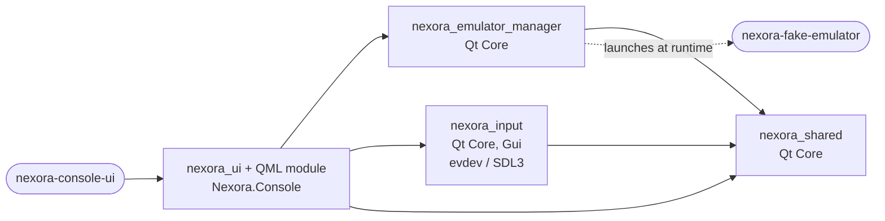
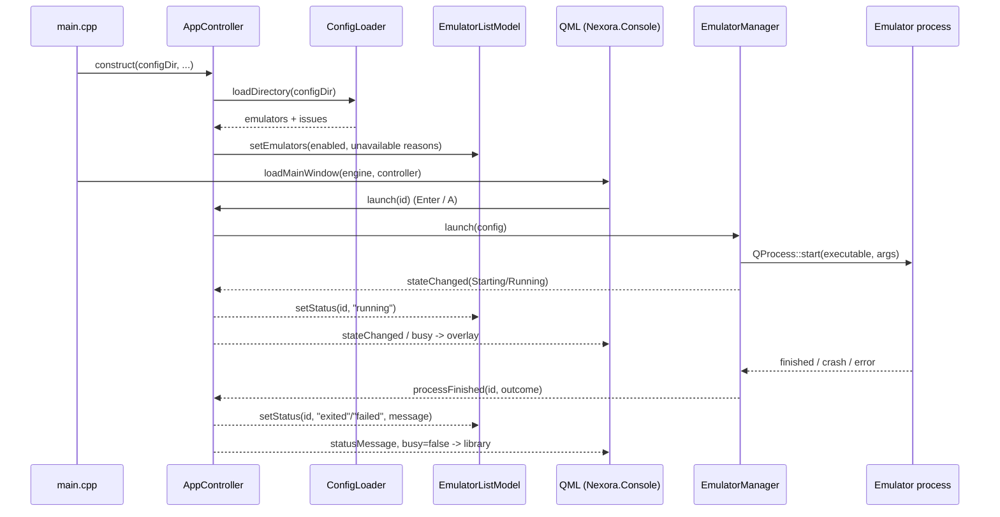
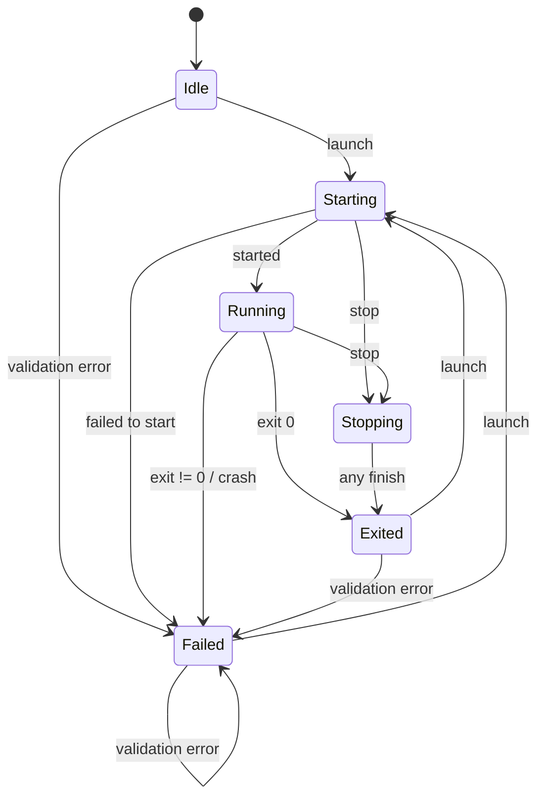
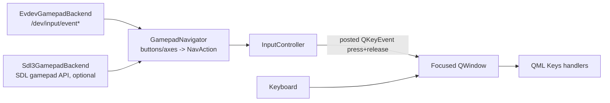

# Nexora OS MVP 1 — Architecture

This document describes the MVP 1 desktop prototype as implemented on the `feature/mvp1` branch. Everything here runs as a normal user-space Qt application; the Buildroot image is future work.

## Components

| Target | Kind | Location | Responsibility |
| --- | --- | --- | --- |
| `nexora_shared` (`Nexora::Shared`) | static library | `shared/` | `EmulatorConfig`, `ConfigLoader` (JSON parsing and validation), config-directory resolution and root detection (`Paths`), logging categories and message handler (`Logging`). Depends only on Qt Core. |
| `nexora_emulator_manager` (`Nexora::EmulatorManager`) | static library | `apps/emulator-manager/` | `EmulatorManager` (launch, supervise, stop one process) and `EmulatorProcessState` (state enum, transition table, error enum and messages). Qt Core only, no UI. |
| `nexora_input` (`Nexora::Input`) | static library | `apps/console-ui/src/input/` | `GamepadNavigator`, `InputController`, `InputBackend` interface, `EvdevGamepadBackend` (Linux), `Sdl3GamepadBackend` (optional). Qt Core + Gui. |
| `nexora_ui` + `nexora_uiplugin` | static library + QML module `Nexora.Console` 1.0 | `apps/console-ui/src`, `apps/console-ui/qml` | `AppController` and `EmulatorListModel` (exposed to QML via `QML_ELEMENT`), `UiBootstrap::loadMainWindow()`, and the QML files compiled into the module (served from `qrc:/qt/qml/Nexora/Console/`). |
| `nexora-console-ui` | executable | `apps/console-ui/src/main.cpp` | Command-line parsing, logging set-up, root policy, config-dir resolution, wiring of controller/input/QML. |
| `nexora-fake-emulator` | executable | `tests/fixtures/fake-emulator/` | Qt-free stand-in for an emulator used by tests and development runs. |
| `nexora_warnings` | interface library | `cmake/NexoraCompilerWarnings.cmake` | Warning flags (`-Wall -Wextra -Wpedantic -Wshadow ...`, optionally `-Werror`) and Qt hygiene defines. |

### Dependency graph

Arrows point from a target to what it links against. `nexora_emulator_manager` has no dependency on input or UI code, and `nexora_input` knows nothing about emulators; `AppController` is the only place where they meet. The fake emulator is not linked into anything: tests receive its path through the `NEXORA_FAKE_EMULATOR` compile definition and the build generates development configs that point at it.

SDL3 is linked privately into `nexora_input` only when `NEXORA_WITH_SDL3` resolves to on (`AUTO` by default: used if `find_package(SDL3 CONFIG)` succeeds). The evdev backend is compiled when `linux/input.h` is available. Both set public compile definitions (`NEXORA_HAVE_SDL3`, `NEXORA_HAVE_EVDEV`).

## Data flow

1. **Config load.** `AppController` calls `ConfigLoader::loadDirectory()` on construction and on `reloadConfig()` (refused while an emulator is active). Disabled entries go to `disabledEmulators`; enabled entries are validated with `EmulatorManager::validateExecutable()` and put into `EmulatorListModel` as `ready` or `unavailable` (with reason). Issues become `configIssues` strings prefixed `Error:` / `Warning:`.
2. **Model to QML.** `EmulatorListModel` exposes roles `emulatorId`, `name`, `executable`, `status` (`ready`, `unavailable`, `starting`, `running`, `stopping`, `exited`, `failed`), `statusText`, `detail`, `available`. `AppController` exposes `state`, `busy`, `statusMessage`, `statusIsError`, `lastOutput`, config and input diagnostics as properties.
3. **Action.** QML calls `app.launch(id)`, `app.stop()`, `app.reloadConfig()` or `app.recentLog()`. `AppController` holds no process logic; it forwards to `EmulatorManager`.
4. **Signals back.** `EmulatorManager` emits `stateChanged`, `outputReceived` and `processFinished`. `AppController` updates per-entry status in the model and the global status message; QML reacts through property bindings (the running overlay is visible while `busy`).

## Process lifecycle

`EmulatorManager` supervises at most one process. States (`EmulatorProcessState.h`):

| State | Meaning | Active (owns a process, new launches rejected) |
| --- | --- | --- |
| `Idle` | Nothing launched yet | no |
| `Starting` | `QProcess::start()` called, `started()` not yet received | yes |
| `Running` | Process is executing | yes |
| `Stopping` | `stop()` requested; SIGTERM sent, kill timer running | yes |
| `Exited` | Last process ended successfully or was stopped on request | no |
| `Failed` | Last launch failed validation, failed to start, exited non-zero or crashed | no |

Valid transitions (`isValidTransition()`):

| From | Allowed to |
| --- | --- |
| `Idle`, `Exited`, `Failed` | `Starting` (launch accepted), `Failed` (launch validation error) |
| `Starting` | `Running`, `Stopping`, `Failed` |
| `Running` | `Stopping`, `Exited`, `Failed` |
| `Stopping` | `Exited` |

An invalid transition is logged as critical (`nexora.process`) and asserts in debug builds.

### Launch

`launch(config)`:

- If a process is active, returns `AlreadyActive` and leaves the state untouched.
- Validation, in order: non-empty `id` (`InvalidConfig`), `enabled` (`Disabled`), then `validateExecutable()`: non-empty and absolute (`InvalidConfig`), exists (`ExecutableMissing`), regular file (`NotAFile`), executable (`NotExecutable`). A validation failure moves to `Failed` synchronously and emits `processFinished` before `launch()` returns.
- Otherwise creates a `QProcess` with the program and explicit argument list, separate stdout/stderr channels, the executable's directory as working directory, and a child-process modifier calling `prctl(PR_SET_PDEATHSIG, SIGTERM)`. State becomes `Starting`; `started()` moves it to `Running`.

### Outcome rules

When a process ends, a `ProcessOutcome` is built (`finalState`, `error`, `exitCode` for normal exits, `stoppedByRequest`, `killed`, user-facing `message`):

| Situation | Final state | Error | Flags |
| --- | --- | --- | --- |
| Normal exit with code 0 | `Exited` | `None` | — |
| Normal exit with non-zero code | `Failed` | `NonZeroExit` | `exitCode` set |
| Crash (signal) | `Failed` | `Crashed` | — |
| `QProcess::FailedToStart` | `Failed` | `FailedToStart` | — |
| Any finish (or failed start) while `Stopping` | `Exited` | `None` | `stoppedByRequest = true`; `killed = true` if SIGKILL was sent |
| Validation error at launch | `Failed` | `InvalidConfig` / `Disabled` / `ExecutableMissing` / `NotAFile` / `NotExecutable` | — |

Other `QProcess` errors (read/write/timeout) are logged only; crashes are resolved in `finished()`. Before reporting, remaining buffered output is drained. The state is updated and the `QProcess` released (`deleteLater`) before `processFinished` is emitted, so a slot may launch again immediately.

### Stop escalation

`stop()` returns `false` when nothing is active and is idempotent while `Stopping`. It moves to `Stopping`, calls `QProcess::terminate()` (SIGTERM) and starts a single-shot timer (default **5 s**, `setStopTimeout()`). If the process is still alive when the timer fires, `kill()` (SIGKILL) is sent and the outcome is marked `killed`.

`shutdown()` (called on `aboutToQuit` and from the destructor) disconnects, kills any live process and waits up to 2 s. It is the only blocking operation and is meant for application exit.

## Safety measures

- **No shell.** Processes are started with `QProcess::setProgram()` + `setArguments()`; arguments are passed verbatim, there is no shell parsing, globbing or variable expansion.
- **Explicit, validated executables.** Config paths are resolved to absolute, cleaned paths (relative paths against the JSON file's directory, never via `PATH`) and re-validated immediately before every launch.
- **No orphaned emulators.** `PR_SET_PDEATHSIG` delivers SIGTERM to the emulator if the launcher dies (Linux only); `shutdown()` kills it on normal exit.
- **Root refusal.** `nexora-console-ui` exits with code 2 when the effective UID is 0 unless `--allow-root` or `NEXORA_ALLOW_ROOT=1` is given; the diagnostics screen shows when it runs as root.
- **Bounded resources.** Captured stdout and stderr are each limited to the most recent 64 Ki characters (`setOutputLimit()`), decoded as UTF-8 incrementally; the UI shows only the last 4000 characters. Config files over 256 KiB are rejected. The in-memory log ring keeps 500 lines.
- **Tolerant, strict config.** Unknown keys are ignored with a warning; any type or value error rejects only that file. Duplicate ids are rejected.
- **Input devices are not grabbed.** The evdev backend opens only devices advertising `BTN_GAMEPAD`, read-only and non-blocking, and never takes exclusive access; keyboards and mice are never held open.

## Input design

- **Backends** (`InputBackend`) translate device events into backend-neutral `GamepadButton` / `GamepadAxis` (normalized to −1..1) calls on the navigator. They run on the GUI thread and never block it.
  - *evdev*: scans `/dev/input/event*`, keeps devices with `BTN_GAMEPAD`, watches `/dev/input` for hotplug (500 ms debounce), uses `EVIOCGABS` ranges for normalization, ignores kernel autorepeat (`value == 2`) and resets the navigator on `SYN_DROPPED` or disconnect. If devices are unreadable because of permissions, the status text says how to join the `input` group.
  - *SDL3*: initializes only `SDL_INIT_GAMEPAD` (with background events allowed and SDL signal handlers disabled), pumps events from a 16 ms timer, and maps SDL's normalized gamepad buttons and left stick.
- **Selection.** `InputController::start()` accepts `auto` (SDL3 if built and it starts, else evdev, else keyboard-only — `auto` never fails), `evdev`, `sdl3` or `none`. Only one backend runs at a time.
- **GamepadNavigator** maps South → Accept, East → Back, Start/Select/Guide → Menu, D-pad/hat/left stick → directions. West and North are unused. Axes use hysteresis (press at |v| ≥ 0.5, release below 0.3) and support flicking to the opposite side. Directions auto-repeat (400 ms, then 120 ms); only the most recently pressed direction repeats, and Accept/Back/Menu never repeat.
- **InputController** turns each `NavAction` into a posted key press + release (`Up/Down/Left/Right`, `Return`, `Escape`, `Menu`) on `QGuiApplication::focusWindow()`. If no Nexora window has focus, the action is dropped. QML therefore only implements keyboard handling. The controller supports a `suspended` flag that drops actions; `AppController` sets it while an emulator process is active (Starting/Running/Stopping), so pressing A in a game cannot trigger the launcher's "Stop emulator" action.

## Logging

`installMessageHandler()` writes every message as `<ISO time> [level] <category>: <message>` to stderr, to the optional `--log-file` (append mode) and to an in-memory ring of 500 lines; the diagnostics screen shows the last 40. Filtering uses the standard `QT_LOGGING_RULES` mechanism.

| Category | Content |
| --- | --- |
| `nexora.app` | Start-up, configuration directory, root policy |
| `nexora.config` | Loading results and per-file issues |
| `nexora.process` | Launch, state transitions (debug), stop/kill, outcomes |
| `nexora.process.output` | Emulator stdout/stderr lines (debug) |
| `nexora.input` | Backend selection, device connect/disconnect, status |
| `nexora.ui` | Status messages, configuration summary, QML load failure |

## Future work

- Buildroot external tree and a bootable x86-64 image; packaging of the application and its dependencies.
- Kiosk start-up (e.g. EGLFS or a minimal compositor), boot directly into the UI.
- A "return to launcher" hotkey/guide-button chord while an emulator is in the foreground (controller input is currently suspended while an emulator runs).
- Per-device navigation state for multiple simultaneous gamepads; caching non-gamepad devices between evdev rescans.
- Persistent settings and configurable controls (SQLite where structured persistence is needed).
- Per-emulator profiles, game library scanning and metadata.
- Validation with real controllers and real emulators on target hardware.
