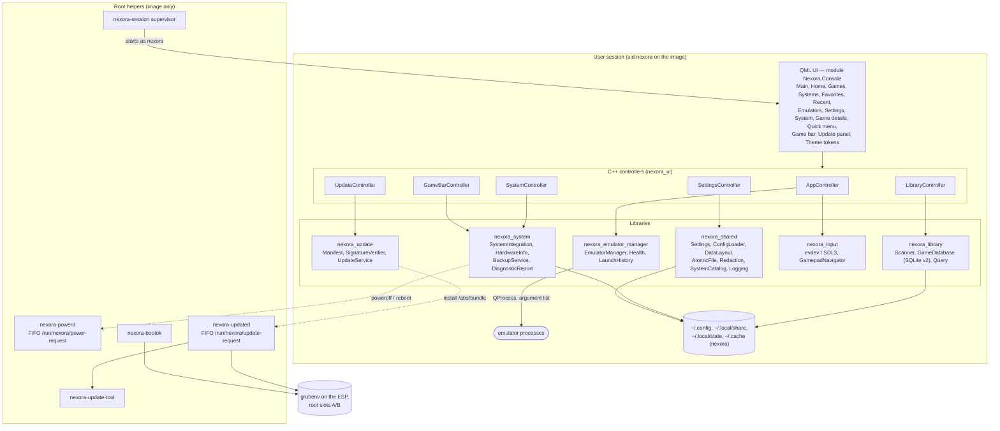
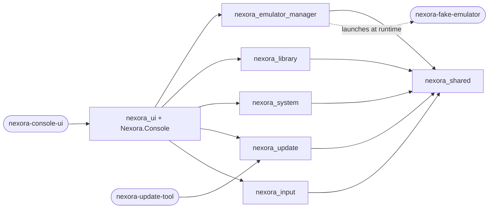
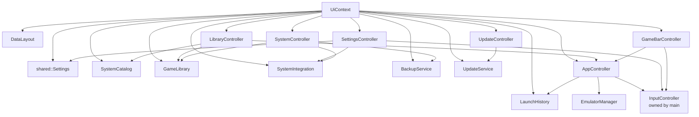

# Architecture

This document describes Nexora OS 0.4.0 (MVP 4) as implemented: a Qt 6 / QML console UI backed by C++ libraries for emulators, the game library, system integration, updates and input, and a Buildroot image with a small set of root-owned shell helpers. The same `nexora-console-ui` binary runs on a desktop Linux host and on the image; behaviour that differs is selected at run time ([System integration](#system-integration)).

Related: [emulator-integration.md](emulator-integration.md), [game-library.md](game-library.md), [controller-support.md](controller-support.md), [user-data.md](user-data.md), [update-system.md](update-system.md), [recovery.md](recovery.md), [security.md](security.md), [design-system.md](design-system.md), [settings.md](settings.md), [buildroot.md](buildroot.md), [building.md](building.md), [testing.md](testing.md).

## Contents

- [Application architecture](#application-architecture)
- [Components](#components)
- [UI object graph](#ui-object-graph)
- [QML-facing API](#qml-facing-api)
- [Main data flows](#main-data-flows)
- [System integration](#system-integration)
- [Start-up and shutdown](#start-up-and-shutdown)
- [Threads](#threads)
- [Safety rules](#safety-rules)
- [Logging](#logging)
- [Image integration](#image-integration)

## Application architecture

QML is presentation only: every system operation goes through a C++ controller, and the only things that cross into root are one-line requests on two FIFOs whose helpers re-verify everything ([security.md](security.md)).

## Components

| Target | Kind | Location | Responsibility |
| --- | --- | --- | --- |
| `nexora_shared` | static library | `shared/` | `Settings` (layered, validated, versioned), `ConfigLoader` (emulator JSON), `EmulatorConfig`, `DataLayout` (all user-data directories), `AtomicFile` (`QSaveFile` writes, size-limited reads, move-aside), `Redaction`, `SystemCatalog` (gaming systems), `Paths`, `Logging` (categories, rotation, ring buffer, runtime level), generated `BuildInfo.h` (version, build id, board) |
| `nexora_emulator_manager` | static library | `apps/emulator-manager/` | `EmulatorManager` (one supervised `QProcess` in its own process group, startup-failure detection, pause/resume, SIGTERM→SIGKILL to the whole group), `SaveStateAdapter` (control-socket, retroarch; [emulator-integration.md](emulator-integration.md#capabilities)), `EmulatorProcessState`, `EmulatorHealth` (stat-only checks), `LaunchHistory` (bounded JSON records) |
| `nexora_library` | static library | `apps/game-library/` | `LibraryScanner` (stat-only walk, progress, cancel), `GameDatabase` (SQLite schema v2, migration with backup, metadata, hidden, system override, `VACUUM INTO` snapshots), `LibraryQuery`, `GameLibrary` (worker-thread scans) |
| `nexora_system` | static library | `apps/system/` | `SystemIntegration` (desktop/embedded: status, power FIFO, volume via `amixer`), `HardwareInfo` (CPU, memory, GPUs, outputs, audio, storage from `/proc`, `/sys`, `statvfs`), `BackupService`, `DiagnosticReport`, `SingleInstanceGuard`, `UnixSignalWatcher` |
| `nexora_update` | static library | `apps/update/` | `Version`, `UpdateManifest` (strict parser), `SignatureVerifier` (Ed25519, OpenSSL 3), `sha256File`, `UpdateService` (state machine, FIFO install request) |
| `nexora-update-tool` | executable | `apps/update/tools/` | `verify --keys DIR --bundle DIR [--current-version --board]`; used by the root helper and release checks |
| `nexora_input` | static library | `apps/console-ui/src/input/` | `ButtonMapping`, `GamepadNavigator` (dead zone, repeat, chord, Start hold), `InputController` (key synthesis, suspension, capture, test mode, devices), `EvdevGamepadBackend`, optional `Sdl3GamepadBackend` |
| `nexora_ui` + QML module | static library | `apps/console-ui/src`, `apps/console-ui/qml` | `UiContext` (owns everything), `AppController`, `LibraryController`, `SettingsController`, `SystemController`, `GameBarController`, `UpdateController`, `NotificationService` ([notifications.md](notifications.md)), `GameSessionManager` ([quick-resume.md](quick-resume.md)), list models (`GameListModel`, `EmulatorListModel`, `SystemListModel`), `UiBootstrap`; the QML module `Nexora.Console` |
| `nexora-console-ui` | executable | `apps/console-ui/src/main.cpp` | command line, headless actions, logging, root policy, single instance, wiring, window |
| `nexora-fake-emulator` | executable | `tests/fixtures/fake-emulator/` | stand-in emulator for tests and development configs |
| image helpers | shell (BusyBox sh) | `buildroot-external/board/nexora-x86_64/rootfs-overlay/` | init scripts, session supervisor, power and update daemons, boot confirmation, recovery menu |

### Dependency graph

The libraries do not know each other; they meet only in `nexora_ui`. `nexora_system` does not link the library (backups receive a database-snapshot callback) or the emulator manager (diagnostics receive plain launch summaries). `nexora_update` links OpenSSL `libcrypto`; Qt Sql is linked only by `nexora_library`.

## UI object graph

`UiContext` owns every backend object and wires them; `main()`, the integration tests and the QML tests build the same graph.

## QML-facing API

Passed to `Main.qml` as initial properties (`UiBootstrap::loadMainWindow()`):

| Property | Object | Main members |
| --- | --- | --- |
| `app` | `AppController` | `emulators` (model with health, version, systems), `state`, `busy`, `paused`, `canPause`, `launchHistory`, `statusMessage`, config issues, input status, `launch()`, `stop()`, `pause()`, `resume()`, `reloadConfig()` |
| `library` | `LibraryController` | `games`, `recentGames`, `favoriteGames`, `recentlyAdded`, `systems`; `searchText`, `filter`, `sortOrder`, `systemFilter`; `scanning`, `scanFilesSeen`, `scanCurrentRoot`, `cancelScan()`; `otherSystemFilter` (`@other`); `gameDetails()`, `setGameMetadata()`, `setGameSystem()`, `setGameEmulator()`, `removeGame()` (the three edits emit an error notice on failure), `defaultEmulatorChoices()`, `setDefaultEmulator()` (validated), `restoreRemovedGames()`, `purgeMissing()`, directories |
| `settings` | `SettingsController` | every preference incl. `theme`, `uiScale`, `reducedMotion`, `startScreen`, `deadzone`, `muted`, `logLevel`, remapping, default profiles, `defaultEmulators` (read-only mirror; changed through `LibraryController.setDefaultEmulator()`), reset |
| `system` | `SystemController` | `hardware`, `osVersion`, `buildId`, `board`, status lines, `refresh()`, `refreshIfStale(ms)`, `refreshCount`, `powerOff()`, `reboot()`, `exportDiagnostics()`, `createBackup()`, `backups()`, `restoreBackup()`, `clearArtworkCache()` |
| `gameBar` | `GameBarController` | game bar `open`, `quickMenuOpen`, CPU/memory/load samples (only while open), session time, battery, network |
| `updates` | `UpdateController` | `state`, `error`, `message`, `progress`, `availableVersion`, `notes`, `currentVersion`, `currentBuildId`, `supported`, `candidateBundles()`, `checkBundle()`, `verify()`, `install()`, `cancel()`, `acknowledgeLastResult()` |

No property or method lets QML run a command or write an arbitrary file.

## Main data flows

| Flow | Where it is described |
| --- | --- |
| Game launch lifecycle (validation → process → history → UI restore) | [emulator-integration.md](emulator-integration.md#launch-lifecycle) |
| Library scan and merge on a worker thread, schema, missing files | [game-library.md](game-library.md#asynchronous-scanning) |
| Controller input → actions → key events, quick menu, test mode | [controller-support.md](controller-support.md#architecture) |
| User-data directories, atomic writes, backup/restore, migration | [user-data.md](user-data.md) |
| Update check → verify → install → trial boot → confirm/rollback | [update-system.md](update-system.md#end-to-end-flow) |
| Settings: layered load, validation, immediate atomic save, live re-apply | [settings.md](settings.md) |

## System integration

`SystemIntegration` is the boundary between the UI and the operating system for status, power and volume:

| | `DesktopSystemIntegration` | `EmbeddedSystemIntegration` |
| --- | --- | --- |
| Selected when | default | `NEXORA_PLATFORM=embedded`, or `/etc/nexora-release` contains `NEXORA_PLATFORM=embedded` |
| Status (OS, host, kernel, uptime, load, memory) | `/etc/os-release`, `/proc` | same |
| Power off / restart | refused (protects the developer's machine) | one line `poweroff\n` / `reboot\n`, non-blocking, to `/run/nexora/power-request` (`nexora-powerd`) |
| Volume / mute | stored preference only | `amixer -q sset Master <n>%` (fallback `PCM`), asynchronous |

Hardware information (`HardwareInfo`) is read on demand by `SystemController::refresh()`, never on the start-up path: the Settings and System screens call `refreshIfStale(30000)` about 150 ms after they become current (the quick menu's info page does the same), so the synchronous probe runs at most once per 30 s; an explicit Reload probes at once. Updates are handled by `UpdateService`/`UpdateController`, which on the desktop report `supported = false` (unless `NEXORA_UPDATE_TEST=1`) and on the image talk to `nexora-updated` ([update-system.md](update-system.md)). `SingleInstanceGuard` (lock in `$XDG_RUNTIME_DIR`) and `UnixSignalWatcher` (SIGTERM/SIGINT/SIGHUP → clean quit) complete the system layer.

## Start-up and shutdown

`main()`:

1. Prefer the offscreen platform for print-and-exit options when there is no display.
2. Parse options; `--version` prints `<version> <build id> <board>`; `--check-config` validates and exits.
3. Build `DataLayout::fromEnvironment()`, detect the platform, install the log handler (on the embedded platform the default log file is `<state>/logs/console-ui.log`; the image's supervisor passes `--log-file /var/log/nexora/console-ui.log`).
4. Root policy (exit 2) and single-instance lock (exit 3).
5. Create `InputController` and `UiContext` (settings loaded, catalog, library, system integration, launch history, backup and update services, controllers; update keys from `<appDir>/../share/nexora/update-keys`, update state in `<state>/update`); the update service reads `last-update.json` here, so the result of a previous update is shown from the first frame ([update-system.md](update-system.md#boot-confirmation-and-rollback-record)).
6. Headless actions (`--backup`, `--restore`, `--export-diagnostics`, `--verify-update`) run against the started context and exit.
7. Start the input backend; `UiContext::start()` creates the data directories (0700) including the update state directory, applies all settings, opens the library (migrating v1 → v2 with a backup if needed) and rescans only if the scan signature changed.
8. Load `Main.qml` (exit 1 on failure), apply the window mode, run the event loop.

Shutdown (`aboutToQuit`): stop a running emulator (bounded wait), cancel and join a scan or hash worker. Settings need no flush; every change was saved atomically.

## Threads

| Thread | Work |
| --- | --- |
| GUI thread | QML, controllers, input backends (non-blocking reads, 16 ms SDL poll), process supervision, small file reads |
| `nexora-library-scan` (low priority) | scanning and merging into SQLite through its own connection |
| update hash worker (low priority) | SHA-256 of the image in 1 MiB chunks, cancellable |

Nothing on the GUI thread waits for disk-heavy work or emulator discovery; health checks only `stat()`.

## Safety rules

- No shell: every process is started with `QProcess` and an argument list; no command strings from metadata.
- Executables are absolute, validated, never looked up in `PATH`, re-validated before each launch; game files are never opened or executed by Nexora.
- The UI refuses to run as root; privileged work is limited to two fixed-format FIFO protocols whose root helpers re-verify everything.
- Every owned file is written atomically (0600) inside owner-only directories; corrupt files are moved aside; every persistent format carries a version.
- Inputs are bounded (file sizes, record counts, log sizes, scan depth and count).
- No telemetry, no network code.
- Details and limits: [security.md](security.md).

## Logging

`installMessageHandler()` writes `<ISO time> [level] <category>: <message>` to stderr, an optional log file (rotated at 2 MiB, 3 old files) and a 500-line ring buffer (shown on the System tab, included in diagnostics reports). `log.level` (`error`/`warning`/`info`/`debug`, default `info`) sets the minimum severity at run time; `QT_LOGGING_RULES` still applies.

| Category | Content |
| --- | --- |
| `nexora.app` | start-up, data directories, root policy, signals |
| `nexora.config` | emulator definitions and settings |
| `nexora.process` / `nexora.process.output` | launches, state transitions, outcomes / emulator output (kept out of the ring) |
| `nexora.input` | backend, devices (connect/disconnect), mapping, chord |
| `nexora.ui` | status messages, QML load |
| `nexora.library` | scans, merges, migration, database problems |
| `nexora.system` | platform, power requests, mixer, hardware, backups |

Update operations are logged by the application and, on the image, by `nexora-updated`/`nexora-bootok` to syslog. Diagnostics reports are redacted ([security.md](security.md#privacy-and-redaction)).

## Image integration

The `buildroot-external/` tree (Buildroot 2026.02.3, Linux 6.12, Qt 6.9.1 EGLFS/KMS, Mesa) builds a UEFI GPT image with an EFI partition, two root slots and a data partition; BusyBox init runs `S01nexora-data`, udev, `S80nexora-powerd`, `S85nexora-updated`, `S90nexora` (UI supervisor or recovery menu) and `S99nexora-bootok`. The A/B image has **not been built or booted yet**. Layout and build: [buildroot.md](buildroot.md); boot order: [recovery.md](recovery.md#boot-and-service-dependencies).
