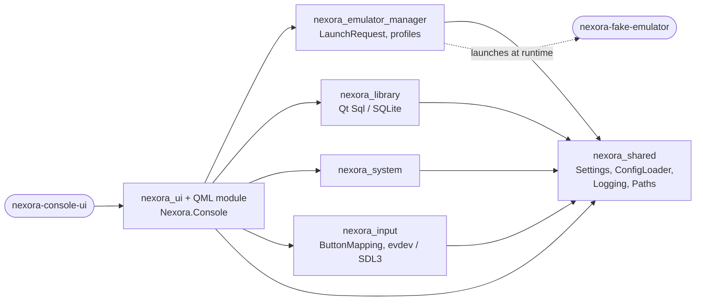
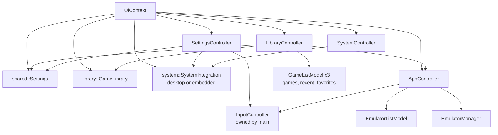
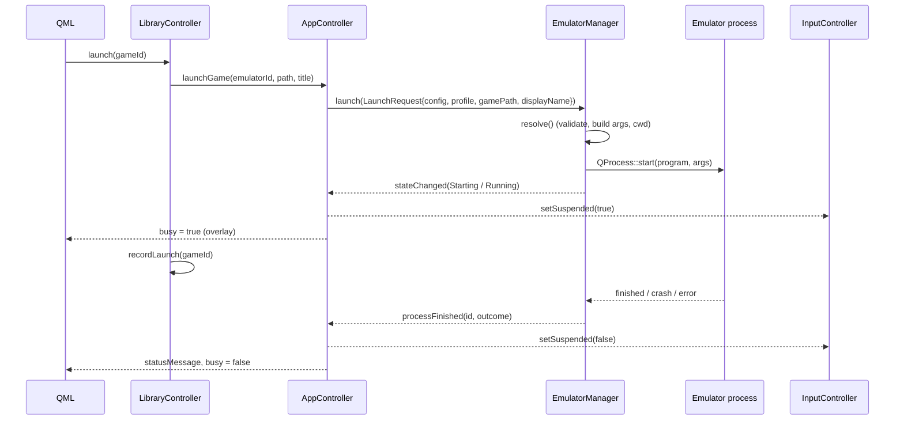
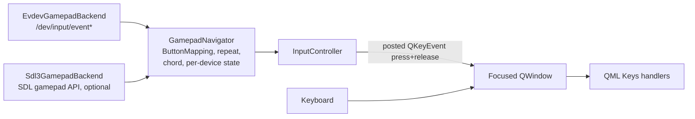

# Nexora OS — Architecture (MVP 2)

This document describes the application as implemented on `main` (version 0.2.0, MVP 2): a Qt 6 / QML console UI with an emulator manager, a game library, persistent settings, configurable controller input and a system-integration layer for the Buildroot image. The same binary runs on a desktop Linux host and on the image; behaviour that differs between the two is selected at run time ([System integration](#system-integration)).

Related documents: [settings.md](settings.md), [game-library.md](game-library.md), [controller-support.md](controller-support.md), [buildroot.md](buildroot.md), [testing.md](testing.md), [development.md](development.md).

## Contents

- [Components](#components)
- [UI and object graph](#ui-and-object-graph)
- [UI to emulator manager](#ui-to-emulator-manager)
- [Process lifecycle](#process-lifecycle)
- [Settings persistence](#settings-persistence)
- [Game library data flow](#game-library-data-flow)
- [Input design](#input-design)
- [System integration](#system-integration)
- [Start-up and shutdown](#start-up-and-shutdown)
- [Safety measures](#safety-measures)
- [Logging](#logging)
- [Buildroot integration](#buildroot-integration)
- [Planned](#planned)

## Components

| Target | Kind | Location | Responsibility | Links |
| --- | --- | --- | --- | --- |
| `nexora_shared` | static library | `shared/` | `EmulatorConfig` / `LaunchProfile`, `ConfigLoader` (emulator JSON validation), `Settings` (layered, validated preferences), `Paths` (config-dir resolution, root detection), `Logging` (categories, message handler, rotation, ring buffer) | Qt Core |
| `nexora_emulator_manager` | static library | `apps/emulator-manager/` | `EmulatorManager` (`LaunchRequest` → `resolve()` → one supervised `QProcess`), `EmulatorProcessState` (states, transition table, errors) | `nexora_shared` |
| `nexora_library` | static library | `apps/game-library/` | `LibraryScanner` (file system walk), `GameDatabase` (SQLite store), `LibraryQuery` (search/filter/sort), `GameLibrary` (owns DB, runs scans on a worker thread) | Qt Core, Qt Sql, `nexora_shared` |
| `nexora_system` | static library | `apps/system/` | `SystemIntegration` (desktop/embedded: status, power, volume, update info), `SingleInstanceGuard`, `UnixSignalWatcher` | Qt Core, `nexora_shared` |
| `nexora_input` | static library | `apps/console-ui/src/input/` | `ButtonMapping`, `GamepadNavigator`, `InputController`, `InputBackend`, `EvdevGamepadBackend` (Linux), `Sdl3GamepadBackend` (optional) | Qt Core, Gui, `nexora_shared`; SDL3 (private, optional) |
| `nexora_ui` (+ `nexora_uiplugin`) | static library + QML module `Nexora.Console` 1.0 | `apps/console-ui/src`, `apps/console-ui/qml` | `UiContext`, `AppController`, `LibraryController`, `SettingsController`, `SystemController`, `EmulatorListModel`, `GameListModel`, `UiBootstrap::loadMainWindow()`, and the QML dashboard (served from `qrc:/qt/qml/Nexora/Console/`) | Qt Qml/Quick + all libraries above |
| `nexora-console-ui` | executable | `apps/console-ui/src/main.cpp` | Command line, `--check-config`, logging, root policy, single instance, wiring, window/display mode | `nexora_ui` |
| `nexora-fake-emulator` | executable | `tests/fixtures/fake-emulator/` | Qt-free stand-in for an emulator (tests and development configs) | — |
| `nexora_warnings` | interface library | `cmake/NexoraCompilerWarnings.cmake` | Warning flags, optional `-Werror` | — |

### Dependency graph



Arrows point from a target to what it links against. The libraries do not know each other: the emulator manager knows nothing about games or input, the library knows nothing about processes, and the input layer knows nothing about emulators. They meet only in `nexora_ui` (`UiContext` and the controllers). The fake emulator is not linked into anything; tests receive its path through `NEXORA_FAKE_EMULATOR`.

SDL3 is linked privately into `nexora_input` only when `NEXORA_WITH_SDL3` resolves to on (`AUTO` by default); the evdev backend is compiled when `linux/input.h` exists. Both set public definitions (`NEXORA_HAVE_SDL3`, `NEXORA_HAVE_EVDEV`).

## UI and object graph

`UiContext` owns every backend object the QML talks to and wires them together. `main()` and the integration/QML tests build the same graph, so tests exercise the real wiring.



| QML context property | C++ object | Used for |
| --- | --- | --- |
| `app` | `AppController` | Emulator list, launch/stop, state, status messages, config issues, input status, log |
| `library` | `LibraryController` | Game lists (`games`, `recentGames`, `favoriteGames`), search/filter/sort, refresh, favorites, folders, scan summary/issues, game options (`gameDetails`, `setGameEmulator`, `launchWithProfile`), missing games (`missingCount`, `purgeMissing`) |
| `settings` | `SettingsController` | All preferences, remapping, default launch profiles, reset, settings issues |
| `system` | `SystemController` | Platform, status lines, power off/restart |

The QML dashboard (`Main.qml`) has five tabs — Home, Games, Emulators, Settings, Diagnostics — plus a header, a hint bar, transient notices (`Toast`), the game options dialog (`GameOptionsDialog`, window-level so Home and Games share it) and the running-emulator overlay. QML only handles key events; controller input arrives as synthesized keys ([Input design](#input-design)).

## UI to emulator manager



1. **Config load.** `AppController` loads the emulator directory (`ConfigLoader::loadDirectory()`) on construction and on `reloadConfig()` (refused while an emulator is active). Disabled entries go to `disabledEmulators`; enabled entries are checked with `EmulatorManager::validateExecutable()` and shown as `ready` or `unavailable` with a reason. Issues become `configIssues`. `configChanged` makes `LibraryController` recompute its scan options (the extension → emulator map comes from the definitions).
2. **Launch entry points.** `app.launch(id)` (Emulators tab; uses the default profile from `emulators.defaultProfiles` if it exists and is enabled), `app.launchProfile(id, profile)` (profile picker; `""` = no profile), `LibraryController.launch(gameId)` → `AppController::launchGame()` (game with its effective emulator and default profile) and `LibraryController.launchWithProfile(gameId, profile)` (game options). All build a `LaunchRequest` and call `EmulatorManager::launch()`.
3. **Resolution.** `EmulatorManager::resolve()` validates the request and computes program, arguments, working directory and stop timeout; details in [Launch](#launch).
4. **Signals back.** `stateChanged`, `outputReceived`, `processFinished`. `AppController` updates the model status and the status message, suspends/resumes controller navigation, and QML reacts through bindings (overlay visible while `busy`). Errors appear as notices.
5. **Return.** Stop from the overlay (`app.stop()`), the controller chord (`InputController::returnToLauncherRequested` → `AppController::returnToLauncher()` → `stop()`), or the emulator exiting by itself.

## Process lifecycle

`EmulatorManager` supervises at most one process. States (`EmulatorProcessState.h`):

| State | Meaning | Active (owns a process, new launches rejected) |
| --- | --- | --- |
| `Idle` | Nothing launched yet | no |
| `Starting` | `QProcess::start()` called, `started()` not yet received | yes |
| `Running` | Process is executing | yes |
| `Stopping` | `stop()` requested; SIGTERM sent, kill timer running | yes |
| `Exited` | Last process ended successfully or was stopped on request | no |
| `Failed` | Last launch failed validation, failed to start, exited non-zero or crashed | no |

Valid transitions (`isValidTransition()`):

| From | Allowed to |
| --- | --- |
| `Idle`, `Exited`, `Failed` | `Starting` (launch accepted), `Failed` (validation error) |
| `Starting` | `Running`, `Stopping`, `Failed` |
| `Running` | `Stopping`, `Exited`, `Failed` |
| `Stopping` | `Exited` |

An invalid transition is logged as critical (`nexora.process`) and asserts in debug builds.

### Launch

`launch(LaunchRequest)`:

- If a process is active, returns `AlreadyActive` and leaves the state untouched.
- `resolve()` validates, in order: non-empty `id` (`InvalidConfig`), `enabled` (`Disabled`), the executable (absolute, exists, regular file, executable), the profile if one was requested (`ProfileNotFound`, `ProfileDisabled`), the working directory (absolute existing directory, `InvalidWorkingDirectory`) and the game file if given (absolute, regular, readable, `GameFileMissing`). A failure moves to `Failed` synchronously and emits `processFinished` before `launch()` returns.
- Arguments: the profile's `arguments` replace the emulator's when the profile defines them. With a game, every argument containing `{file}` gets the absolute game path substituted; if none contains it, the path is appended. Without a game, arguments containing `{file}` are dropped.
- Working directory: profile, else emulator `workingDirectory`, else the executable's directory. Stop timeout: the emulator's `stopTimeoutMs` (500–60000 ms), else the manager default (5 s).
- A `QProcess` is created with the program and the explicit argument list, separate stdout/stderr channels, the working directory, and a child-process modifier calling `prctl(PR_SET_PDEATHSIG, SIGTERM)`. State becomes `Starting`; `started()` moves it to `Running`.

### Outcome rules

| Situation | Final state | Error | Flags |
| --- | --- | --- | --- |
| Normal exit with code 0 | `Exited` | `None` | — |
| Normal exit with non-zero code | `Failed` | `NonZeroExit` | `exitCode` set |
| Crash (signal) | `Failed` | `Crashed` | — |
| `QProcess::FailedToStart` | `Failed` | `FailedToStart` | — |
| Any finish (or failed start) while `Stopping` | `Exited` | `None` | `stoppedByRequest`; `killed` if SIGKILL was sent |
| Validation error | `Failed` | the validation error | — |

Other `QProcess` errors are logged only.

**Output log.** With `setOutputLogDirectory()` (the application passes `$XDG_STATE_HOME/nexora/emulator-logs`), each accepted launch writes `<id>.log`: a header with time, program, arguments and working directory, every output line prefixed `out| ` or `err| `, and a footer with the outcome message. The previous file is renamed to `<id>.log.1` first, so the output of a crash survives a relaunch. Files are capped at 1 MiB (`setOutputLogLimit()`); writes are flushed per chunk so a killed launcher leaves the log readable. Failing to write only logs a warning. Validation failures write nothing (no process was started). Remaining buffered output is drained before reporting. State is updated and the `QProcess` released (`deleteLater`) before `processFinished` is emitted, so a slot may launch again immediately.

### Stop escalation

`stop()` returns `false` when nothing is active and is idempotent while `Stopping`. It sends SIGTERM (`QProcess::terminate()`) and starts a single-shot timer with the active stop timeout; if the process is still alive then, SIGKILL is sent and the outcome is marked `killed`. `shutdown()` (application exit and destructor) kills any live process and waits up to 2 s; it is the only blocking operation.

## Settings persistence

```mermaid
sequenceDiagram
    participant QML
    participant SC as SettingsController
    participant S as shared::Settings
    participant F as settings.json
    participant X as Listeners

    QML->>SC: e.g. volume = 35 / remap(action, button)
    SC->>S: setValue(key, value)
    S->>S: validate (Spec); equal to layered default -> drop override
    S-->>X: valueChanged(key, value)
    SC->>S: save()
    S->>F: QSaveFile (temp file + atomic rename)
```

- **Load** (`UiContext` constructor, before anything reads preferences): built-in defaults ← `<appDir>/../share/nexora/settings-defaults.json` ← `/etc/nexora/settings-defaults.json` ← user file (`$XDG_CONFIG_HOME/nexora/settings.json` or `--settings-file`). Invalid entries are dropped with issues; an unusable user file is moved to `settings.json.corrupt-<timestamp>`. `--check-config` loads in read-only `Inspect` mode.
- **Change**: every UI change is validated and saved immediately; there is no "apply" step and nothing to flush on exit.
- **Listeners** (`valueChanged`): `SettingsController` applies `input.mapping` to the `InputController` (with the stricter `ButtonMapping` validation; invalid → defaults), `audio.volume` to `SystemIntegration::applyVolume()` (embedded only), and `display.mode` to the window. `LibraryController` reacts to `library.*` (rescan if the scan signature changed; sort order). `UiContext` forwards `emulators.defaultProfiles` to `AppController`. `input.backend` and `display.resolution` are only read at start-up.
- **Reset**: drops all overrides, keeps the old file as `settings.json.bak`, and re-applies everything.

Key reference: [settings.md](settings.md).

## Game library data flow

```mermaid
sequenceDiagram
    participant LC as LibraryController (UI thread)
    participant GL as GameLibrary (UI thread)
    participant W as Worker thread
    participant DB as GameDatabase (SQLite)

    LC->>GL: setScanOptions(roots, extension map, followSymlinks)
    LC->>GL: refresh() (signature changed or manual)
    GL->>W: QThread::create(scan + merge) (low priority)
    W->>W: LibraryScanner::scan()
    W->>DB: second connection: applyScan() (BEGIN IMMEDIATE)
    W->>DB: meta scan-signature, last-scan; entries()
    W-->>GL: finished(ScanJob: result, stats, entries)
    GL->>GL: swap cached entries (or reload if a UI write happened meanwhile)
    GL-->>LC: entriesChanged, scanFinished(stats, issues)
    LC->>LC: LibraryQuery::apply() -> GameListModels
```

- **Scan on a worker thread.** `LibraryScanner::scan()` is a pure function of the file system and the options (only `stat()`, never opens game files). At most one scan runs; a refresh during a scan is queued once. A cancelled scan (shutdown) changes nothing.
- **Merge on the worker thread.** A `GameDatabase` (one Qt SQL connection) is used only from the thread that opened it, so the worker opens its own connection to the same file (WAL mode; Qt's default SQLite busy timeout of 5 s). `applyScan()` reads all existing rows once, inserts new files, updates only changed rows, and marks vanished files as not present — all in one `BEGIN IMMEDIATE` transaction (a deferred one could fail with `SQLITE_BUSY_SNAPSHOT` if the UI wrote between its read and its first write). It never touches favorites, play history or emulator overrides. The worker connection is opened without recovery, so it can never move the database aside while the UI holds it. The worker then reads the entry list; the UI thread swaps it in, unless a UI write (favorite, launch, override, purge) happened since the scan started — tracked by a write generation counter — in which case it reloads from its own connection so the write is not lost. An in-memory database (tests) cannot be shared and is merged on the UI thread.
- **Queries in memory.** `GameLibrary` keeps the present entries in memory; `LibraryQuery::apply()` filters and sorts them for the three list models (search is debounced by 150 ms).
- **Rescan policy.** At start-up and on configuration/settings changes, a scan runs only when the scan signature (directories, extension map, symlink option) differs from the one stored after the last completed scan; manual refresh always scans.

Measured on a synthetic library of 10 000 files (Release build, 4-core container, 3 runs; not on target hardware) with `NEXORA_LIBRARY_BENCH=1 tst_gamelibrary benchmarkEventLoopStall`, which records the longest gap between 5 ms timer ticks on the owner (UI) thread:

| | Total (scan + merge + load) | Longest UI stall, merge on the worker (current) | Longest UI stall, merge on the UI thread (before) |
| --- | --- | --- | --- |
| First scan | 0.19–0.25 s | 5 ms | 118–139 ms |
| Unchanged rescan | 0.15–0.21 s | 5–6 ms | 72–95 ms |

5 ms is the resolution of the measurement. Rebuilding the visible lists afterwards (search + sort) still runs on the UI thread (≈ 8 ms for 10 000 entries). Details, schema and missing-file rules: [game-library.md](game-library.md).

## Input design



- **Backends** translate device events into backend-neutral `GamepadButton` / `GamepadAxis` calls tagged with a device id; they run on the GUI thread and never block it. Selection: `auto` (SDL3 if built and it starts, else evdev, else keyboard-only; never fails), `evdev`, `sdl3`, `none`; from `--input-backend` or `input.backend`, at start-up.
- **GamepadNavigator** maps buttons to actions through the configurable `ButtonMapping` (default South → Accept, East → Back, Start → Menu, North → Favorite, West → Search, L1/R1 → previous/next tab, Select → Options; unbound Guide/Select → Menu). D-pad, hat and left stick always give directions with hysteresis (0.5 / 0.3) and auto-repeat (400 ms, then 120 ms). State is kept per device. Holding Select + Start on one device for 1 s emits `returnToLauncherRequested`.
- **InputController** posts a key press + release for each action (`Up/Down/Left/Right`, `Return`, `Escape`, `Menu`, `Favorites`, `Search`, `PageUp`, `PageDown`, `Context1`) to the focused window. It drops actions while **suspended** (`AppController` suspends it while an emulator is active, because devices are not grabbed), forwards the chord even while suspended, and supports **capture** of the next button for remapping.

Details, layouts, limitations and a hardware test checklist: [controller-support.md](controller-support.md).

## System integration

`SystemIntegration` is the only boundary between the UI and the operating system.

| | `DesktopSystemIntegration` | `EmbeddedSystemIntegration` |
| --- | --- | --- |
| Selected when | default | `NEXORA_PLATFORM=embedded`, or `/etc/nexora-release` contains `NEXORA_PLATFORM=embedded` (`NEXORA_PLATFORM=desktop` forces desktop) |
| Status (OS name, host, kernel, uptime, load, memory) | from `/etc/os-release`, `/proc` | same |
| Power off / restart | never (returns an error; protects the developer's machine) | one line `poweroff\n` or `reboot\n` written non-blocking to the FIFO `/run/nexora/power-request`, served by the root helper `nexora-powerd`; supported only while the FIFO exists and is writable |
| Volume | stored preference only | `amixer -q sset Master <n>%`, asynchronously; on failure retried with `PCM`; newer requests supersede pending ones; supported only if `/usr/bin/amixer` is executable |
| Updates (`updateInfo()`) | not supported; "managed by the host system" | not supported; reports the installed image version (`NEXORA_VERSION`, optional `NEXORA_UPDATE_CHANNEL` from `/etc/nexora-release`) and "write a newer image to update". This is the seam for a future update mechanism; it never blocks or uses the network. |
| Display status | screens, resolution and refresh rate from `QGuiApplication::screens()` (in `SystemController`, which has Qt Gui), refreshed on screen hot-plug | same |
| Input device status | `InputController` (backend, devices), shown next to the system status | same |

The FIFO protocol and its security reasoning are documented in [buildroot.md](buildroot.md#power-requests-poweroffreboot). `SystemController` exposes platform, status lines and power actions to QML; the Settings tab asks for confirmation (second press) before powering off or restarting.

Other system pieces (`nexora_system`):

- **Single instance:** `SingleInstanceGuard` takes a `QLockFile` at `$XDG_RUNTIME_DIR/nexora-console-ui.lock` (temp dir as fallback); stale locks of crashed instances are detected. A second instance exits with code 3.
- **Signals:** `UnixSignalWatcher` turns SIGTERM, SIGINT and SIGHUP into a Qt signal on the main thread (self-pipe); `main()` then quits the event loop normally, so the emulator is stopped and the scan joined.

## Start-up and shutdown

`main()` (`apps/console-ui/src/main.cpp`):

1. Select the offscreen platform for print-and-exit options (`--help`, `--version`, `--check-config`) when there is no display.
2. Create `QGuiApplication`, parse options: `--config-dir`, `--settings-file`, `--library-db`, `--log-file`, `--input-backend`, `--fullscreen`, `--windowed`, `--allow-root`, `--check-config`.
3. Resolve the emulator directory (`--config-dir` > `NEXORA_CONFIG_DIR` > `<appDir>/../share/nexora/emulators`) and the settings paths.
4. `--check-config`: validate emulator definitions, settings (read-only) and the controller mapping, print a report, exit 0/1.
5. Install the log handler (stderr, optional rotating file, ring buffer).
6. Root policy: exit 2 when running as root, unless `--allow-root` or `NEXORA_ALLOW_ROOT=1`.
7. Single-instance lock: exit 3 if another instance runs.
8. Create `InputController` and `UiContext` (loads settings, creates `SystemIntegration` from `NEXORA_PLATFORM`, loads the emulator configuration, creates the controllers).
9. Start the input backend (`--input-backend` or `input.backend`); failure only logs a warning (keyboard still works).
10. `UiContext::start()`: apply mapping and volume, open the library database (failure disables the library), rescan if the signature changed.
11. Install the signal watcher and an `aboutToQuit` handler that calls `UiContext::shutdown()`.
12. Load `Main.qml` (exit 1 on failure), apply the initial window size from `display.resolution`, and show full screen or windowed (`--fullscreen`/`--windowed`, else `display.mode`, which then also follows later changes).
13. Run the event loop.

**Shutdown** (`aboutToQuit`, after a signal or `Ctrl+Q`): `UiContext::shutdown()` kills a running emulator (waits up to 2 s) and waits for a running scan. Settings need no flush because every change was already saved.

## Safety measures

- **No shell.** Processes are started with `QProcess` and an explicit argument list; no shell parsing, globbing or expansion. Game paths are passed only as arguments.
- **Validated executables.** Paths are absolute and cleaned (relative ones against the JSON file, never via `PATH`) and re-validated before every launch.
- **Game files are never executed or opened by Nexora.** The scanner only lists and `stat()`s; only configured directories are scanned and `/` is refused.
- **No orphaned emulators.** `PR_SET_PDEATHSIG` delivers SIGTERM if the launcher dies; `shutdown()` kills it on exit.
- **Unprivileged.** Refuses to run as root by default. Privileged operations on the image go through the two-word power FIFO only.
- **Bounded resources.** Captured stdout/stderr ≤ 64 Ki characters each (UI shows the last 4000); config and settings files ≤ 256 KiB; log ring 500 lines; log file rotated; scan limits (depth 16, 100 000 files, 200 issues).
- **Tolerant, strict configuration.** Invalid entries are rejected individually with visible issues; unusable settings and database files are moved aside, never deleted.
- **Input devices are not grabbed** and only gamepads are kept open; navigation is suspended while an emulator runs.

## Logging

Emulator output additionally goes to the per-emulator [output log](#outcome-rules) files when enabled. `installMessageHandler()` writes `<ISO time> [level] <category>: <message>` to stderr, to the optional `--log-file` and to an in-memory ring of 500 lines (the Diagnostics tab shows the last 40; emulator output is kept out of the ring). The log file is rotated when it would exceed **2 MiB**, keeping **3** old files (`file.1` … `file.3`). Filtering uses `QT_LOGGING_RULES`.

| Category | Content |
| --- | --- |
| `nexora.app` | Start-up, configuration directory, root policy, signals |
| `nexora.config` | Emulator definitions and settings: load results and issues |
| `nexora.process` | Launch, state transitions (debug), stop/kill, outcomes |
| `nexora.process.output` | Emulator stdout/stderr lines (debug) |
| `nexora.input` | Backend selection, devices, mapping problems, chord |
| `nexora.ui` | Status messages, configuration summary, QML load failure |
| `nexora.library` | Scans, merges, database problems |
| `nexora.system` | Platform, power requests, mixer |

## Buildroot integration

The `buildroot-external/` tree (BR2_EXTERNAL, Buildroot 2026.02.3) builds an x86-64 UEFI disk image that boots into the console UI. In short: the `nexora-os` package builds this CMake project (SDL3 off; Buildroot has no SDL3 package, so the image uses evdev); BusyBox init starts the root `nexora-powerd` helper and a supervisor that runs `nexora-console-ui --fullscreen --log-file /var/log/nexora/console-ui.log` as user `nexora` on tty1 with EGLFS/KMS and `NEXORA_PLATFORM=embedded`, restarting it with backoff; recovery logins stay available on the serial console and tty2. The tree was validated locally with `check-package`, the defconfig symbol check and the kernel-fragment check (the `buildroot.yml` CI job runs the first two; it has not yet run on GitHub). A full image build is in progress and unverified: no image has been built or booted yet.

Everything else — layout, image contents, start-up, recovery, power protocol, users and permissions, QEMU instructions — is in [buildroot.md](buildroot.md).

## Planned

Not implemented in MVP 2:

- On-screen keyboard and folder browser.
- An update mechanism behind `SystemIntegration::updateInfo()`.
- Applying `display.resolution` as a real KMS mode; switching the input backend without restart.
- Configurable chord and repeat timings; per-controller mappings; an evdev correction database or SDL3 on the image.
- Caching non-gamepad devices between evdev rescans (each `/dev/input` change re-probes all event nodes).
- Metadata, artwork and save-state integration.
- Validation with real controllers, real emulators and the image on target hardware.
