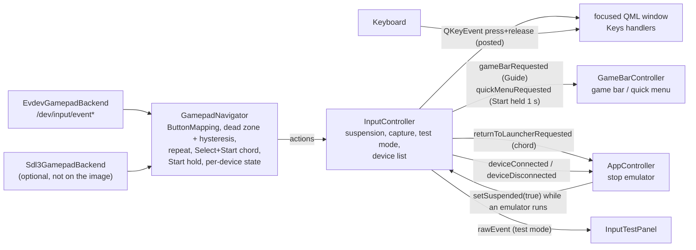

# Controller support

Nexora is meant to be used with a game controller only. This page describes how gamepad input reaches the UI, which controllers are expected to work, how buttons are mapped and remapped, and how to test with real hardware.

**Test status (MVP 4, 0.4.0):** no physical controller has been tested with either backend, on a desktop or on the image. Hotplug and the button layouts of the evdev backend are tested with virtual uinput controllers that reproduce the main driver families (`tst_evdevhotplug`, [Testing without a controller](#testing-without-a-controller)). Everything below is implemented and covered by unit and UI tests on the mapping and navigation logic (`tst_gamepadnavigator`, `tst_buttonmapping`, `tst_inputcontroller`, plus `tst_appcontroller`/`tst_uicontext` for the chord, disconnect notice and remapping, and the QML tests `tst_navigation.qml`, `tst_quickmenu.qml` for controller-only operation with synthesized keys), but the device handling of the evdev and SDL3 backends has only been exercised without devices. The SDL3 backend is compiled and its tests run in the `build-sdl3` CI job. Use the [manual test checklist](#manual-test-checklist) when testing real pads.

Code: `apps/console-ui/src/input/`.

## Contents

- [Architecture](#architecture)
- [Backends](#backends)
- [Button names and controller layouts](#button-names-and-controller-layouts)
- [Default mapping](#default-mapping)
- [Configurable mapping](#configurable-mapping)
- [Directions, dead zone and repeat](#directions-dead-zone-and-repeat)
- [Quick menu and game bar](#quick-menu-and-game-bar)
- [Devices and test input](#devices-and-test-input)
- [Keyboard](#keyboard)
- [While an emulator runs](#while-an-emulator-runs)
- [Multiple controllers and disconnects](#multiple-controllers-and-disconnects)
- [Known limitations](#known-limitations)
- [Testing without a controller](#testing-without-a-controller)
- [Manual test checklist](#manual-test-checklist)
- [Planned](#planned)

## Architecture



1. A **backend** (`EvdevGamepadBackend` or `Sdl3GamepadBackend`) turns device events into backend-neutral `GamepadButton` presses/releases and `GamepadAxis` values (−1…1), tagged with a device id.
2. **`GamepadNavigator`** maps buttons to navigation actions through the `ButtonMapping`, turns D-pad/hat/left stick into directions (dead zone, hysteresis, auto-repeat), ignores OS key auto-repeat for non-directional actions, and detects the Select + Start chord and a 1 s Start hold.
3. **`InputController`** owns the navigator and at most one backend, drops actions while suspended, handles remap capture and test mode, keeps the list of connected devices, and posts a synthesized key press + release for each action to the focused window.
4. The **QML UI** only handles ordinary key events, so gamepad and keyboard behave identically.

All of this runs on the GUI thread; backends never block it (non-blocking reads / a 16 ms poll timer).

## Backends

Selected by `--input-backend` or, if not given, the `input.backend` setting (default `auto`); changes to the setting apply at the next start.

| Value | Behaviour |
| --- | --- |
| `auto` | SDL3 if it was built in and initialises; otherwise evdev if built in and `/dev/input` exists; otherwise no backend ("No gamepad backend available; keyboard only"). Never fails. |
| `evdev` | evdev only. Fails (backend "none", keyboard still works) if not built or `/dev/input` is missing. |
| `sdl3` | SDL3 only. Fails if not built in or SDL cannot initialise the gamepad subsystem. |
| `none` | Controller input disabled. |

Only one backend runs at a time. The Diagnostics tab shows the backend name, its status text and the connected devices.

### evdev (default on Linux)

Built whenever `linux/input.h` is available.

- Reads `/dev/input/event*` directly, non-blocking.
- **Device filter:** kept open are gamepads (`BTN_GAMEPAD`) and joystick-class devices (numbered buttons `BTN_TRIGGER` … `BTN_BASE4` plus `ABS_X`/`ABS_Y`: generic USB pads, the Logitech Dual Action / RumblePad 2, wheels, flight sticks). Keyboards, mice, touchpads, power buttons and motion sensor nodes (`INPUT_PROP_ACCELEROMETER`) are closed again immediately.
- **Layout correction:** each device gets a layout from its kernel driver (sysfs) and vendor id, logged on connect (`evdev: <name> [vvvv:pppp] driver <driver>, layout <layout>`):

| Layout | Devices | Effect |
| --- | --- | --- |
| `positional` | hid-playstation, hid-sony, hid-nintendo, hid-wiimote, generic HID gamepads (8BitDo, …) | kernel codes as they are |
| `xbox-labels` | driver `xpad` (all Xbox-compatible USB pads and the Xbox 360 wireless receiver), `hid-steam`, any Microsoft (`045e`) or Valve (`28de`) device | `BTN_X` → `west`, `BTN_Y` → `north` (these drivers report the Xbox X/Y labels, which the kernel defines as `BTN_NORTH`/`BTN_WEST`) |
| `joystick` | joystick-class devices | button 1 `west`, 2 `south`, 3 `east`, 4 `north`, 5/6 `l1`/`r1`, 9 `select`, 10 `start` (Logitech Dual Action order, from SDL's gamecontrollerdb) |
| `joystick-playstation` | DragonRise "USB Gamepad" `0079:0006` | button 1 `north`, 2 `east`, 3 `south`, 4 `west`, 5/6 `l1`/`r1`, 9 `select`, 10 `start` |

  Joystick-class pads whose buttons follow another order (cheap SNES/Saturn-style pads, arcade sticks in D-input mode) may have their face buttons in the wrong place; remap from the settings screen.
- **Not grabbed:** other programs (including a running emulator) receive the same events. This is why navigation is [suspended while an emulator runs](#while-an-emulator-runs).
- **Codes used** (kernel gamepad codes, see [Button names](#button-names-and-controller-layouts)):

| evdev code | Nexora button / axis |
| --- | --- |
| `BTN_SOUTH` (= `BTN_A`) | `south` |
| `BTN_EAST` (= `BTN_B`) | `east` |
| `BTN_NORTH` (= `BTN_X`) | `north` |
| `BTN_WEST` (= `BTN_Y`) | `west` |
| `BTN_START` / `BTN_SELECT` / `BTN_MODE` | `start` / `select` / `guide` |
| `BTN_TL` / `BTN_TR` | `l1` / `r1` |
| `BTN_DPAD_UP/DOWN/LEFT/RIGHT` | D-pad directions |
| `ABS_X` / `ABS_Y` | left stick (range from `EVIOCGABS`) |
| `ABS_HAT0X` / `ABS_HAT0Y` | hat (D-pad reported as an axis, −1…1) |

Kernel auto-repeat events (value 2) are ignored; the navigator does its own repeat. After `SYN_DROPPED` the device's state is reset and events are ignored until the next `SYN_REPORT`.

- **Permissions:** the user needs read access to `/dev/input/event*`, normally via the `input` group (`sudo usermod -aG input $USER`, then log in again). If no gamepad could be opened and some nodes were refused, the status reads "No gamepad readable: N of M input devices in /dev/input are not accessible (permission denied). Add your user to the 'input' group …". On the Buildroot image the `nexora` user is in `input` and a udev rule sets `/dev/input/event*` to `root:input 0660` ([buildroot.md](buildroot.md#users-and-permissions)). Nexora refuses to run as root by default.
- **Hotplug:** `/dev/input` is watched (`QFileSystemWatcher`); changes are debounced by 500 ms and new event nodes are probed. A freshly created node is `root:root 0600` until udev applies the `input` group, so nodes refused with a permission error are tried again every second, up to 5 times after each change. A read error (e.g. `ENODEV` on unplug) closes the device. On the image the kernel driver is a module that eudev loads by modalias when the controller is plugged in ([which controllers](linux_gamepad_drivers.md#támogatás-a-nexora-os-ben)). Tested with virtual controllers: `tst_evdevhotplug` (below).

### SDL3 (optional)

Built only with `-DNEXORA_WITH_SDL3=ON` or `AUTO` when SDL3 is found ([building.md](building.md#optional-sdl3-backend)). Ubuntu 24.04 does not package SDL3 and **Buildroot 2026.02.3 has no SDL3 package, so the image uses evdev only** (`-DNEXORA_WITH_SDL3=OFF` in `nexora-os.mk`).

- Uses SDL's gamepad API, which normalises button positions across many controllers through SDL's built-in controller database. Nexora does not ship or load an additional mapping database; SDL's own mechanisms (e.g. the `SDL_GAMECONTROLLERCONFIG` environment variable) are SDL behaviour and were not tested with Nexora.
- Only the gamepad subsystem is initialised; events are polled every 16 ms on the GUI thread.
- Hints set: background joystick events allowed (input keeps arriving while an emulator window has focus), SDL signal handlers disabled.
- Buttons used: South/East/West/North, Start, Back (→ `select`), Guide, D-pad, left/right shoulder (→ `l1`/`r1`); axes: left stick X/Y. Triggers, right stick and other buttons are ignored.
- On Linux SDL also reads `/dev/input`, so the same permission requirements apply (expected; not tested).

## Button names and controller layouts

Buttons are named by **position**, not by the label printed on them, because labels differ between manufacturers. The table shows the conventional labels at each position. Whether a specific pad reports these positions correctly depends on its kernel driver (evdev) or SDL's database (SDL3). **None of these controllers has been tested**; the rows are what the Linux gamepad conventions and SDL lead us to expect.

| Nexora name | Position | Xbox | PlayStation | Nintendo (Switch Pro) | 8BitDo (X-input mode) |
| --- | --- | --- | --- | --- | --- |
| `south` | bottom face button | A | Cross (✕) | B | B (acts as A) |
| `east` | right face button | B | Circle (○) | A | A (acts as B) |
| `west` | left face button | X | Square (□) | Y | Y (acts as X) |
| `north` | top face button | Y | Triangle (△) | X | X (acts as Y) |
| `start` | right centre button | Menu (☰) / Start | Options | + | Start |
| `select` | left centre button | View / Back | Share / Create | − | Select |
| `guide` | central logo button | Xbox button | PS button | Home | Home / logo |
| `l1` | left shoulder | LB | L1 | L | L |
| `r1` | right shoulder | RB | R1 | R | R |

So with the default mapping, "confirm" is Cross on PlayStation and **B** on Nintendo-layout pads (the bottom button). 8BitDo pads expose different layouts depending on their mode (X-input, D-input, Switch, macOS); the column above assumes X-input mode, where they appear as an Xbox pad with Nintendo-style labels.

The kernel defines `BTN_NORTH` and `BTN_WEST` as aliases of `BTN_X` and `BTN_Y`. `xpad` and `hid-steam` report the *label* codes `BTN_X`/`BTN_Y` for the Xbox X (left) and Y (top) buttons (checked in the Linux 6.12 sources), so the evdev backend swaps them back for these devices (layout `xbox-labels`, [evdev](#evdev-default-on-linux)). SDL3 corrects such differences through its database.

## Default mapping

Synthesized keys are fixed; the button for each remappable action comes from `input.mapping`.

| Action | Default button | Xbox / PlayStation / Nintendo label | Synthesized key | In the dashboard |
| --- | --- | --- | --- | --- |
| `accept` | `south` | A / ✕ / B | `Return` | Select / launch / confirm (destructive actions ask first: a confirmation dialog whose default is Cancel, e.g. stopping a game from the running overlay, Restart and Power off in the game bar; a few rows such as Reset preferences and the game bar's Stop emulator need a second press instead) |
| `back` | `east` | B / ○ / A | `Escape` | Leave a text field, close the profile picker or game options, cancel a dialog or remap capture; inside a page where nothing consumes it, move focus to the tab bar; on the tab bar it re-enters the page. Never quits the UI and never stops a running emulator. |
| `menu` | `start` | Menu / Options / + | `Menu` | Open the System tab (holding Start for 1 s while a game runs opens the quick menu instead) |
| `favorite` | `north` | Y / △ / X | `Favorites` | Toggle favorite of the focused game (Home rows, Games grid); in the Emulators tab's profile picker, make the selected profile the default |
| `search` | `west` | X / □ / Y | `Search` | Open the Games tab with the search field focused |
| `prevTab` | `l1` | LB / L1 / L | `PageUp` | Previous tab (Home, Games, Systems, Favorites, Recent, Emulators, Settings, System) |
| `nextTab` | `r1` | RB / R1 / R | `PageDown` | Next tab |
| `gameBar` | `guide` | Xbox / PS / Home | (none; `InputController::gameBarRequested`) | With no game running: open or close the [game bar](game-bar.md). While a game runs: open or close the [quick menu](#quick-menu-and-game-bar). Works while navigation is suspended. |
| `options` | `select` | View / Share (Create) / − | `Context1` | Open the launch options of the focused game (Home rows, Games grid); closes them again. Accept on a game opens its [details](game-library.md#game-details). |
| Up/Down/Left/Right | D-pad, hat, left stick | (fixed) | arrow keys | Move focus; Up at the top of a page moves to the tab bar; Left/Right change values on Settings rows |

The dashboard behaviour is defined in `apps/console-ui/qml/` and covered by `tst_qmlsmoke` with key events. The hint bar at the bottom shows the keys that apply to the focused element.

## Configurable mapping

The `input.mapping` setting maps action → button ([settings.md](settings.md#keys)):

```json
"input.mapping": {"accept": "south", "back": "east", "menu": "start", "favorite": "north",
                  "search": "west", "prevTab": "l1", "nextTab": "r1", "gameBar": "guide",
                  "options": "select"}
```

- Remappable actions: `accept`, `back`, `menu`, `favorite`, `search`, `prevTab`, `nextTab`, `gameBar`, `options`.
- Buttons: `south`, `east`, `west`, `north`, `start`, `select`, `guide`, `l1`, `r1`.

Validation (`ButtonMapping::fromVariantMap()`), applied when the setting is loaded or changed:

| Rule | On violation |
| --- | --- |
| Action and button names must be known | Whole mapping ignored |
| A button may be bound to only one action | Whole mapping ignored |
| `accept` and `back` must be bound | Whole mapping ignored |
| Other actions may be left out | They are simply unbound, except `options` (added in a later version): when a stored mapping does not mention it and `select` is free, it is bound to `select`, so mappings saved before it existed gain it |

An ignored mapping falls back to the **default** mapping; the settings screen lists "Controller mapping ignored (<reasons>); using defaults" and the log has a warning in `nexora.input`.

### Remapping from the UI

- On the Settings tab, each action has a row under "Controller". **Left/Right** cycles the button directly (works with keyboard only). **Accept** starts capture (`SettingsController.beginRemap(action)`): the next **non-directional** button press (any of the nine buttons above) becomes the binding. Directions keep navigating during capture; the captured press is not delivered as an action. Capture ends after the press or after 5 s (`cancelRemap()`), and is ignored while input is suspended.
- Note: during capture *every* face button, including the one bound to `back`, is captured as the new binding; the keyboard's Esc, pressing Confirm on the row again, or the 5 s timeout cancels (the row hint says so). Capture is only offered while a gamepad backend is running (`settings.controllerAvailable`); with backend `none` the row tells keyboard users to pick a button with ← →.
- `SettingsController.remap(action, button)` binds directly (used by Left/Right and by tests).
- Binding a button that another action already uses **swaps** them: the other action gets the old button of the remapped action, so every action stays reachable (example: binding `accept` to `east` moves `back` to `south`).
- Each change is validated and saved immediately. "Reset to defaults" restores the default mapping together with all other settings.

## Directions, dead zone and repeat

| Behaviour | Details |
| --- | --- |
| Directions | D-pad buttons, hat axes and the left stick always navigate. |
| Dead zone | `input.deadzone` (5–60 %, default 25 %; Settings › Controllers › "Analog stick dead zone", steps of 5), applied live. Readings with \|v\| below the dead zone count as centred; a direction is pressed at \|v\| ≥ dz + (1 − dz) × 0.4 and released below dz + (1 − dz) × 0.15 (default: press at 0.55, release below 0.36). Flicking straight to the opposite side registers. Tested: `tst_gamepadnavigator` (0.25 ignores 0.2, presses at 0.6, releases at 0.3; clamping). |
| Auto-repeat | A held direction repeats after 400 ms, then every 120 ms. Only the most recently pressed direction repeats; releasing it stops repeat even if an older direction is still held. Buttons never repeat. |
| Key-repeat filter | A button reported as pressed again without a release (kernel/OS auto-repeat) fires Accept, Back and the other actions only once per physical press; only navigation repeats. |
| Return to launcher | Hold **Select + Start** on the same controller for **1 second**: the running emulator is asked to stop (SIGTERM, SIGKILL after its stop timeout, 5 s by default). Fires once per hold; releasing either button earlier cancels it. Works while navigation is suspended. Does nothing when no emulator is starting/running. |
| Guide / Select fallback | If `guide` is not bound to any action, pressing it triggers `gameBar`; an unbound `select` triggers `menu`. Older stored mappings gain `options` on Select when Select is free, so with the default mapping neither fallback applies. |

Pressing Start or Select also triggers their normal action (by default `menu` and `options`) when navigation is not suspended, including at the start of the chord. While an emulator runs, navigation is suspended, so only the chord, Guide and the Start hold count.

## Quick menu and game bar

`GameBarController` (`apps/console-ui/src/GameBarController.cpp`) owns both overlays:

| Input | No game running | Game running |
| --- | --- | --- |
| Guide (controller) | toggles the game bar | opens the **quick menu**; Guide again closes it |
| Hold Start 1 s (Select not held) | — | opens the quick menu |
| Ctrl+G (keyboard) | toggles the game bar | toggles the game bar |

While either overlay is open, controller input flows to the shell even though an emulator runs. Quick menu items: Return to game (resumes the emulator first if it is paused), Pause/Resume emulator (only when the emulator definition is `pausable`), controller status, Volume and Mute, Display settings (display mode, resolution, interface scale), System info, Exit game (confirmation "Unsaved progress in the emulator may be lost"; default button Cancel). Tested: `tst_quickmenu.qml`, `tst_appcontroller`.

On the image the emulator owns the display (EGLFS/KMS), so the quick menu becomes visible when the shell regains it; this hand-over has not been tested on the image.

## Devices and test input

- **Device list:** `InputController.devices` lists each connected pad as `{id, name, backend, connectedAt}`; shown in Settings › Controllers, on the System tab and as a count on Home.
- **Disconnect notice:** a pad that disappears while an emulator runs produces the notice "Controller disconnected: <name>"; the emulator is not stopped (`tst_appcontroller`). Connect/disconnect events are also logged in `nexora.input`.
- **Test input:** Settings › Controllers › "Test input" opens `InputTestPanel`. In test mode every button and axis event is shown as text (`south pressed`, `LeftX -0.82`) and **not** turned into navigation; holding the button currently mapped to Back (east by default; the panel names it) for 2 s leaves test mode (`tst_inputcontroller`), and Escape closes it from the keyboard. Every other key stays inside the panel (L1/R1, Menu and Search included), and if the panel is hidden from outside it closes and leaves test mode.

## Keyboard

The keyboard always works, with or without a controller backend. Because gamepad actions are delivered as key events, the same keys drive the UI:

| Key | Same as |
| --- | --- |
| Arrow keys | Directions |
| Enter / Return | `accept` |
| Esc | `back` |
| Menu (context-menu key) | `menu` |
| Page Up / Page Down | `prevTab` / `nextTab` |

`Favorites` and `Search` are media keys most keyboards lack, so the dashboard also accepts these keyboard-only keys:

| Key | Effect |
| --- | --- |
| `F1` | System tab (like Menu) |
| `Ctrl+G` | Open / close the game bar (Guide opens the quick menu instead while a game runs) |
| `F` (no modifier) on a focused game | Toggle favorite |
| `O` (no modifier) on a focused game | Launch options (like `options`) |
| `/` or `Ctrl+F` | Search on the Games tab |
| `Ctrl+Tab` / `Ctrl+Shift+Tab` | Next / previous tab |
| `Backspace` | Same as Esc |
| `Space` | Activates buttons and rows like Enter |
| `Ctrl+Q` | Quit (development convenience) |

Editing a game's title and notes works with the controller through the on-screen keyboard (`OnScreenKeyboard.qml`, tested in `tst_gamedetails.qml`). **Search and adding a library folder still need a keyboard**: those text fields do not use the on-screen keyboard yet.

## While an emulator runs

- The launcher shows the running overlay; Accept on its **Stop** button asks "Stop the emulator?" (default Cancel) because unsaved progress may be lost. The Select + Start chord below stops without asking.
- Gamepads are not grabbed, so the emulator receives the same input. While an emulator is starting, running or stopping, `InputController` is **suspended**: all navigation actions are dropped, so pressing A in a game cannot click "Stop" in the launcher. Held directions and repeat are reset on suspend and resume.
- The Select + Start chord, Guide (quick menu) and the 1 s Start hold are still detected while suspended; they are the controller-only ways back to the shell.
- When the emulator exits, navigation resumes.
- Many emulators have their own Select + Start bindings (e.g. exit or menu); test the interaction per emulator.

## Multiple controllers and disconnects

- State is kept per device (evdev: file descriptor; SDL3: joystick instance id). One pad's stick noise does not release another pad's held direction.
- The most recent direction press, from any pad, is the one that repeats.
- The chord counts only when Select and Start are held on the **same** pad.
- All pads drive the same UI; there are no player slots.
- On disconnect (evdev read error, SDL `GAMEPAD_REMOVED`) that device's held buttons, directions and chord are dropped immediately, so nothing stays "stuck"; the device list updates and, while a game runs, a notice is shown. Reconnecting is picked up by hotplug.

## Known limitations

- No physical controller tested (evdev or SDL3).
- No rumble, battery level, LEDs, gyro or touchpad.
- Triggers, right stick, L3/R3 and paddles are not used.
- No per-controller mapping; one mapping for all pads.
- evdev corrects only the families in the layout table above (no full correction database): joystick-class pads in a different button order and generic HID pads with unusual button numbering may have swapped or missing buttons.
- Bluetooth controllers are not supported on the image (no Bluetooth stack or pairing screen); Wii Remotes, Joy-Cons and the Switch Online pads only work over Bluetooth. Out-of-tree drivers (`xone` for the Xbox Wireless Adapter, `xpadneo`, the community T150 driver) are not included.
- SDL3 is not available on the Buildroot image.
- The input backend cannot be switched without a restart.
- The chord and Start-hold durations (1 s) and the repeat timings are fixed; only the dead zone is configurable.
- Search and library-folder entry need a keyboard; the recovery menu and GRUB menu need a keyboard.
- Devices are not grabbed while an emulator runs.

## Testing without a controller

`nexora-virtual-pad` (built with the tests, `build/<preset>/bin/`) plugs a virtual controller into the machine through Linux uinput. Its profiles reproduce the families of [linux_gamepad_drivers.md](linux_gamepad_drivers.md) with the ids and key codes their real drivers send: `xbox360`, `xbox-series`, `steam`, `dualsense`, `dualshock4`, `switch-pro`, `8bitdo-pro2`, `dual-action`, `dragonrise`, `wheel` (`--list`). It needs write access to `/dev/uinput`, and the console UI needs read access to the created node:

```sh
sudo modprobe uinput
sudo chmod 0666 /dev/uinput            # until the next reboot; or a udev rule
build/debug/bin/nexora-console-ui --windowed --input-backend evdev &
build/debug/bin/nexora-virtual-pad --profile dualsense
```

The pad stays plugged in until stdin closes. Type a button by position (`south`, `east`, `west`, `north`, `l1`, `r1`, `select`, `start`, `guide`), a direction (`up`, `down`, `left`, `right`), `hold`/`release BUTTON` for chords (e.g. `hold select`, `start`, `release select`), `unplug` and `plug` to test hotplug, or `quit`. Whether the user running the UI can read the new node depends on the desktop's udev rules (`input` group); the evdev status on the System tab says when it cannot.

**Automated:** `tst_evdevhotplug` plugs every profile into a running `EvdevGamepadBackend`, presses each button and checks the position that arrives, the D-pad, two pads at once, replugging, and that a keyboard and a motion sensor node are ignored. It is skipped where `/dev/uinput` is not writable; CI loads `uinput` and allows the test's own devices with a udev rule ([ci.yml](../.github/workflows/ci.yml)).

**On the image in QEMU** (not yet run; the A/B image has not been built, see [buildroot.md](buildroot.md#running-in-qemu)): start QEMU with a monitor (`-monitor unix:/tmp/nexora-mon,server,nowait`) and hot-plug the controller while the UI runs:

- a real USB pad: `device_add usb-host,vendorid=0x045e,productid=0x028e,id=pad1` (needs `-device qemu-xhci` and access to the host's `/dev/bus/usb` node); `device_del pad1` unplugs it. The guest sees the real device, so its own driver and layout are used.
- a virtual pad, no hardware: run `nexora-virtual-pad` on the host, find its node (`/dev/input/by-id/` or the `eventN` under the printed sysfs path), then `device_add virtio-input-host-pci,evdev=/dev/input/eventN,id=pad1`. The guest gets a `virtio_input` device with the same name, ids and codes (needs `CONFIG_VIRTIO_INPUT`, in [`linux.fragment`](../buildroot-external/board/nexora-x86_64/linux.fragment)); the layout is then chosen from the vendor id, as for a Bluetooth pad. Commands typed into `nexora-virtual-pad` arrive in the VM.

Send the monitor commands with `echo 'device_add …' | socat - UNIX-CONNECT:/tmp/nexora-mon`. Check the serial log for `Gamepad connected:` and the `evdev: … layout …` line.

## Manual test checklist

Run on a desktop with the debug build (`build/debug/bin/nexora-console-ui --windowed --input-backend evdev`, later `sdl3` if built) and on the image in QEMU with USB pass-through ([buildroot.md](buildroot.md#running-in-qemu)). Watch the log (`nexora.input` category) and the Diagnostics tab. Record controller model, connection (USB/Bluetooth), driver (`cat /proc/bus/input/devices`), backend and result for each item.

1. **Detection:** with the pad connected before start, the Diagnostics tab shows the backend, "1 gamepad connected" and the pad's name.
2. **Permissions:** as a user without `input` group membership, the status explains the permission problem; after adding the group and logging in again, the pad is detected.
3. **Hotplug:** unplug → "Gamepad disconnected" in the log and device list updates; plug in again → detected within about a second.
4. **Face buttons by position:** bottom = confirm, right = back, top = favorite, left = search. Note any swapped pair (especially west/north on Xbox pads under evdev).
5. **Start / Select / Guide:** Start opens the System tab (menu action); Select on a game opens its launch options; Guide opens and closes the game bar; Accept on a game opens its details.
6. **Shoulders:** L1/R1 switch to the previous/next tab.
7. **Directions:** D-pad, left stick and (if the pad reports one) the hat all move focus; a held direction repeats; releasing stops immediately; resting stick does not drift.
8. **Remap:** remap `favorite` to L1 from the settings screen; check that `prevTab` moved to the old favorite button, the new binding works, it survives a restart, and an unpressed capture times out after 5 s.
9. **Invalid mapping:** put `"accept": "south", "back": "south"` in the settings file; the settings screen reports the problem and the default mapping works.
10. **Emulator suspension:** launch a game; pressing buttons in the emulator does not navigate the launcher behind it.
11. **Quick menu over a game:** in a running emulator press Guide (and, separately, hold Start for 1 s) → the Nexora window comes to the front with the quick menu; the pad navigates it; Guide or "Return to game" returns to the emulator (and resumes it if it was paused); Exit game asks for confirmation. Ctrl+G still opens the game bar.
12. **Return chord:** in a running emulator hold Select + Start for 1 s → emulator stops and the launcher has focus again; releasing earlier does nothing; an emulator that ignores SIGTERM is killed after its stop timeout.
13. **Two pads:** hold a direction on pad 1 while moving the stick on pad 2; holding Select on one pad and Start on the other does not trigger the chord.
14. **Disconnect while holding:** hold a direction and unplug; repeat stops.
15. **Keyboard alongside:** arrows/Enter/Esc keep working with a pad connected.
16. **Dead zone and test input:** open Settings › Controllers › "Test input"; a resting stick reports nothing at the default 25 %; change the dead zone and check navigation; hold the Back button (B by default) for 2 s to leave.
17. **Backend `none`:** `--input-backend none` → pad ignored, keyboard works.
18. **Back and confirmations:** Back inside a page moves to the tab bar; Accept on Stop in the running overlay asks first and Cancel is focused.

## Planned

- Testing with real Xbox, PlayStation, Nintendo and 8BitDo pads and recording the results in this document.
- A fuller correction database for evdev (beyond the layout families above), or SDL3 on the image once Buildroot packages it.
- Bluetooth: BlueZ on the image and a controller pairing screen.
- Per-controller mappings, configurable chord and repeat timings.
- On-screen keyboard for search and folder entry; a folder browser.
