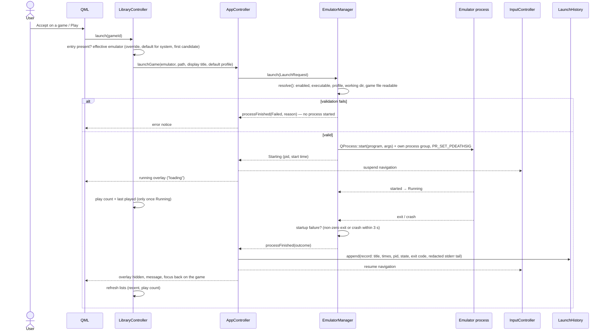

# Emulator integration

Nexora does not contain emulators. It launches native Linux emulator executables that you configure, supervises the process, and brings the shell back when it ends. This page describes the emulator definition format (the "adapter" description), the availability checks, the launch lifecycle, pausing, failure handling and the launch history.

> **Compatibility:** no real emulator has been tested with Nexora. All behaviour below is verified with `nexora-fake-emulator` (`tests/fixtures/fake-emulator/`), a small program that can start slowly, print, crash, ignore SIGTERM or exit with any code. No emulator is shipped in the image; its only definition, `example.json`, runs `/bin/true`.

Code: `shared/include/nexora/shared/EmulatorConfig.h`, `shared/src/ConfigLoader.cpp`, `apps/emulator-manager/` (`EmulatorManager`, `EmulatorProcessState`, `EmulatorHealth`, `LaunchHistory`), `apps/console-ui/src/AppController.cpp`, `LibraryController.cpp`.

## Contents

- [Emulator definitions](#emulator-definitions)
- [Gaming systems](#gaming-systems)
- [Health and availability](#health-and-availability)
- [Launch lifecycle](#launch-lifecycle)
- [Process states and outcomes](#process-states-and-outcomes)
- [Pause and resume](#pause-and-resume)
- [Capabilities](#capabilities)
- [Stopping](#stopping)
- [Launch history and output logs](#launch-history-and-output-logs)
- [Choosing the emulator for a game](#choosing-the-emulator-for-a-game)
- [Failure handling](#failure-handling)
- [Limitations](#limitations)
- [Future plan: RetroArch and PPSSPP](#future-plan-retroarch-and-ppsspp)

## Emulator definitions

Each emulator is one JSON object in its own `*.json` file in the configuration directory. Lookup (first match wins): `--config-dir`, `NEXORA_CONFIG_DIR`, `<appDir>/../share/nexora/emulators` (on the image `/usr/share/nexora/emulators`, root-owned).

```json
{
  "id": "snes9x",
  "name": "Snes9x",
  "version": "1.63",
  "executable": "/usr/bin/snes9x",
  "arguments": ["-fullscreen", "{file}"],
  "workingDirectory": "/tmp",
  "extensions": [".sfc", ".smc"],
  "systems": ["snes"],
  "pausable": true,
  "stopTimeoutMs": 3000,
  "enabled": true,
  "profiles": [
    {"id": "windowed", "name": "Windowed", "arguments": ["{file}"]}
  ]
}
```

(An illustrative definition; Nexora has not been tested with Snes9x.)

| Key | Type | Required | Rules |
| --- | --- | --- | --- |
| `id` | string | yes | `^[a-z0-9][a-z0-9_-]{0,63}$`, unique across files |
| `name` | string | yes | non-empty |
| `version` | string | no | ≤ 64 characters; shown on the Emulators tab and in details (informational only, not detected) |
| `executable` | string | yes | absolute, or relative to the JSON file's directory; never looked up in `PATH` |
| `arguments` | string array | no | passed verbatim, no shell; `{file}` is replaced by the absolute game path (also inside an argument such as `--rom={file}`); if no argument contains it, the path is appended; without a game, arguments containing `{file}` are dropped |
| `enabled` | bool | no | default `true` |
| `workingDirectory` | string | no | relative to the JSON file; default: the executable's directory |
| `extensions` | string array | no | `^\.[a-z0-9]{1,16}$`; the game files this emulator accepts |
| `systems` | string array | no | system ids from the [catalog](#gaming-systems); unknown ids are reported and dropped |
| `pausable` | bool | no | default `false`; allows [pause/resume](#pause-and-resume) with SIGSTOP/SIGCONT |
| `capabilities` | object | no | `{pause?, saveState?}`; see [Capabilities](#capabilities) |
| `stopTimeoutMs` | int | no | 500–60000, default 5000: time between SIGTERM and SIGKILL |
| `profiles` | object array | no | ≤ 32; `{id, name, emulator?, arguments?, workingDirectory?, enabled?}`; profile `arguments` replace the emulator's |

Files over 256 KiB are rejected; an invalid file is skipped and reported while valid ones load; duplicate ids are errors; unknown keys are warnings. `nexora-console-ui --check-config` validates a directory without starting the UI. Definitions without `version`, `systems` or `pausable` (MVP 2 format) still load unchanged (`tst_configloader`).

## Gaming systems

The built-in catalog (`config/systems/systems.json`, compiled in as a resource, format version 1) defines 19 systems: `nes`, `snes`, `n64`, `gb`, `gbc`, `gba`, `nds`, `genesis`, `sms`, `gamegear`, `psx`, `ps2`, `psp`, `gamecube`, `wii`, `pce`, `atari2600`, `arcade`, `dos`, each with a name, short name and extensions. Extensions such as `.iso`, `.chd` and `.zip` deliberately map to several systems; such games get a list of candidates and no automatic system until you pick one in the game details. An extension alone never makes a file "compatible": a game can only be launched with an emulator that declares its extension.

## Health and availability

`checkHealth()` (`apps/emulator-manager/src/EmulatorHealth.cpp`) only `stat()`s the executable; it never runs the emulator.

| Health | Meaning |
| --- | --- |
| `Available` | absolute path, regular file, executable |
| `Disabled` | `enabled: false` |
| `ExecutableMissing` | file does not exist |
| `NotExecutable` | exists but is not an executable regular file |
| `InvalidConfig` | e.g. relative executable after resolution |

The Emulators tab, Settings › Emulators and the Home health card show health and detail; the executable is checked again on every launch.

## Launch lifecycle



This covers the brief's lifecycle: validate the entry, check availability, validate the launch configuration, show a loading state, start through the process manager, record start time and pid, detect startup success or failure, track termination, keep a bounded diagnostic record, restore the shell, update play history and refresh the library state.

## Process states and outcomes

`EmulatorManager` supervises one process at a time.

| State | Meaning | New launch accepted |
| --- | --- | --- |
| `Idle` | nothing launched yet | yes |
| `Starting` | `QProcess::start()` called | no (`AlreadyActive`) |
| `Running` | process executing | no |
| `Stopping` | SIGTERM sent, kill timer running | no |
| `Exited` | ended successfully or stopped on request | yes |
| `Failed` | validation error, failed to start, non-zero exit or crash | yes |

| Situation | Final state | Error | Notes |
| --- | --- | --- | --- |
| exit 0 | `Exited` | `None` | |
| non-zero exit | `Failed` | `NonZeroExit` | `exitCode` set |
| crash (signal) | `Failed` | `Crashed` | |
| cannot start | `Failed` | `FailedToStart` | `startupFailure` |
| non-zero exit or crash within the startup grace (3 s) after `started` | `Failed` | as above | `startupFailure`, message "<name> failed during startup (exit N)" |
| finish while `Stopping` | `Exited` | `None` | `stoppedByRequest`; `killed` if SIGKILL was needed |
| validation error | `Failed` | `InvalidConfig`, `Disabled`, `ExecutableMissing`, `ProfileNotFound`, `ProfileDisabled`, `InvalidWorkingDirectory`, `GameFileMissing`, … | no process started |

The full transition table is tested in `tst_processstate`; outcomes with the fake emulator in `tst_emulatormanager`.

## Pause and resume

Only for definitions with `"pausable": true`, and only while `Running`. `pause()` sends SIGSTOP, `resume()` SIGCONT, both to the emulator's whole process group (see [Stopping](#stopping)); `paused` is exposed to QML and the quick menu shows "Pause emulator"/"Resume emulator" only when `app.canPause` is true. The quick menu's "Return to game" resumes a paused emulator before closing. Stopping a paused group sends SIGCONT before SIGTERM so it can exit. Tested: `tst_emulatormanager` (process state `T` in `/proc/<pid>/stat`, non-pausable refused, stop while paused), `tst_appcontroller`, `tst_quickmenu.qml`. SIGSTOP freezes the whole process group; whether a given emulator tolerates it (audio devices, timers) is untested.

## Capabilities

What an emulator can do beyond being started and stopped. Optional; a definition without it behaves exactly as before.

```json
"capabilities": {
  "pause": true,
  "saveState": {
    "adapter": "control-socket",
    "timeoutMs": 10000,
    "launchArguments": ["--control-socket", "{control-socket}"],
    "resumeArguments": ["--load-state", "{state-file}"]
  }
}
```

| Key | Rules |
| --- | --- |
| `pause` | bool; same as `pausable` (kept for compatibility). If both are given and disagree, the emulator is treated as not pausable and a warning is reported. |
| `saveState.adapter` | `"control-socket"` or `"retroarch"` |
| `saveState.timeoutMs` | 1000–120000, default 10000: how long a save or quit request may take |
| `saveState.launchArguments` | control-socket only, required: arguments appended to every launch that uses save states; must contain `{control-socket}`, replaced by the socket path |
| `saveState.resumeArguments` | control-socket only, required: appended when the game starts from a state; must contain `{state-file}`, replaced by the state's absolute path |
| `saveState.port` | retroarch only: network command port on 127.0.0.1, 1024–65535, default 55355 |

A malformed `capabilities` block does **not** make the definition invalid: the broken capability is dropped, a warning is reported (`--check-config`, System tab), and the emulator stays usable without it. Unknown keys inside it are warnings. Placeholders are substituted into explicit argument lists; nothing passes through a shell. The adapter's arguments are appended after the emulator's (or profile's) arguments and the game path.

Save states are used by Quick Resume (game sessions, [console-experience.md](console-experience.md#dependency-aware-plan) step 3); the adapters are `nexora::emulator::SaveStateAdapter` (`apps/emulator-manager/include/nexora/emulator/SaveStateAdapter.h`).

### control-socket adapter

Nexora's own line protocol, for emulators or wrapper scripts that implement it. For each launch Nexora listens on a fresh Unix socket in the temporary directory, readable only by its own user, and passes the path through `{control-socket}`. The emulator connects once (further connections are refused) and answers one line per request (UTF-8, at most 4096 bytes):

| Nexora sends | Emulator answers |
| --- | --- |
| `SAVE <directory>` | `OK <absolute path of the new state file>` or `ERR <message>` |
| `QUIT` | `OK` and exits, or `ERR <message>` |

A save succeeds only when the answer arrives within `timeoutMs` and the file is a non-empty regular file inside `<directory>` (symbolic links and paths outside it are rejected). If the emulator disconnects or exits while a request is pending, the request fails at once. A failed or timed-out save never stops the game. The emulator must be running (not SIGSTOPped) to answer.

`nexora-fake-emulator` implements the protocol (`--control-socket`, `--load-state`, plus `--save-error`, `--save-empty`, `--save-delay-ms`, `--ignore-quit` to simulate failures). Tested: `tst_savestateadapter` (save, quit, resume from the state, ERR answer, empty file, timeout, one request at a time, not connected, refused quit, disconnect during save).

### retroarch adapter (unverified)

**Not verified with RetroArch**: written from RetroArch's documented configuration keys and network commands and tested only against a stand-in UDP listener (`tst_savestateadapter`), because RetroArch is not integrated yet ([emulator-integracio.md](emulator-integracio.md)).

- Launch: writes `<session>/nexora-retroarch.cfg` (network commands on 127.0.0.1:`port`, `savestate_directory = <session>/retroarch`, slot 0, no automatic save/load, no quit confirmation, `config_save_on_exit = false`) and adds `--appendconfig <file>`.
- Save: sends the UDP command `SAVE_STATE`, waits until a `*.state` file in `<session>/retroarch` appears or changes and has the same size and time on two polls (100 ms apart), then **copies** it to a new file in the requested directory. RetroArch overwrites its slot file in place; the copy keeps earlier states intact.
- Resume: copies the state to `<session>/retroarch/<game file name without extension>.state` and adds `--entryslot 0`.
- Quit: sends `QUIT`. RetroArch sends no answer, so success only means the datagram was sent; the caller still waits for the process to exit and then sends SIGTERM.
- Needs the loopback interface up on the image. RetroArch's network commands are unauthenticated: any local process can send them while the game runs.

## Stopping

- Quick menu › Exit game (confirmation: unsaved progress may be lost), the running overlay's Stop (same confirmation, default Cancel), the game bar's Stop emulator (second press), or holding **Select + Start** for 1 s (no confirmation; [controller-support.md](controller-support.md)).
- The emulator is started as the leader of its own **process group** (`setpgid(0, 0)` between fork and exec), and every signal goes to the whole group (falling back to the direct child if the group is gone), so wrapper scripts and helper processes it spawns are stopped, paused and resumed with it.
- `stop()` sends SIGTERM to the group and arms a timer with the emulator's `stopTimeoutMs`; if the process is still alive, SIGKILL to the group. A `stop()` during `Starting`, before the pid is known, sends SIGTERM as soon as the process has started instead of waiting for the kill timer. When the emulator exits after a requested stop, anything left in its group (e.g. a helper that ignores SIGTERM) gets SIGKILL. Tested: `tst_emulatormanager::stopTerminatesGrandchildren`, `stopDuringStartingIsFast` (fake emulator `--spawn-child`).
- On application exit `shutdown()` kills the running emulator's group and waits up to 2 s; `PR_SET_PDEATHSIG` sends SIGTERM to the direct child if the UI dies (grandchildren are not covered by that).

## Launch history and output logs

- **Launch history** (`<state>/launch-history.json`, `{"version":1,"records":[…]}`): one record per finished launch with emulator id, profile, **game title (never the path)**, start/end time, pid, final state, error, exit code, startup-failure flag and the last ≤ 4 KiB of stderr, redacted. Newest 50 kept; written atomically; a corrupt file is moved aside. The System tab shows the newest 10; diagnostics reports include the newest 20 as one-line summaries. Tested: `tst_launchhistory`, `tst_appcontroller`.
- **Output logs** (`<state>/emulator-logs/<id>.log`, previous run `<id>.log.1`): header (time, program, arguments, working directory), every output line prefixed `out| `/`err| `, outcome footer; 1 MiB cap. These contain game paths and whatever the emulator prints.

## Choosing the emulator for a game

Candidates are the enabled emulators that declare the file's extension. The effective emulator is (`LibraryController::effectiveEmulatorId()`):

1. the per-game override (game details › emulator), if still a candidate;
2. else `emulators.defaultForSystem[<game's system>]` (Settings › Emulators › "Default emulator — <system>"), if that emulator is a candidate. The settings row exists only for catalog systems with games or a compatible emulator and offers "Automatic" plus the enabled emulators that declare the system; `LibraryController::setDefaultEmulator()` refuses anything else (including the "Other" bucket);
3. else the first candidate (definitions sorted by file name).

The launch profile is `emulators.defaultProfiles[<emulator>]` when it exists and is enabled, unless a profile was chosen explicitly.

## Failure handling

| Case | What the user sees |
| --- | --- |
| Missing executable | emulator marked unavailable with the reason; launch refused with a notice |
| Invalid configuration | file listed under configuration issues (System tab), entry not loaded |
| Unsupported game format | the game shows "No emulator handles this file type" and cannot be launched |
| Game file vanished | "Game file is missing"; the UI stays usable; a rescan updates the entry |
| Failed process creation | "Emulator failed to start" with the system error |
| Startup failure | "<name> failed during startup (exit N)" with the stderr tail on the System tab |
| Non-zero exit / crash later | message with exit code or "crashed"; history record kept |
| Duplicate launch | refused while a process is active (`AlreadyActive`) |
| Controller disconnected while playing | notice "Controller disconnected: <name>"; the emulator keeps running |
| Shell exits while an emulator runs | the emulator's process group is killed (bounded wait), or, if the UI crashes, the direct child receives SIGTERM via `PR_SET_PDEATHSIG` |

## Limitations

- No real emulator tested; no emulator packaged in the image.
- One process at a time; no cheat or per-game configuration integration; emulators are not told about `<data>/saves`. Save states work only through the [adapters](#capabilities); the RetroArch adapter is unverified.
- `version` is declared, not detected; capabilities are declared, not probed.
- Emulators run as the same user as the shell and are not sandboxed ([security.md](security.md#known-limitations)).
- On the image the emulator gets the display only after the shell releases it (EGLFS); how a given emulator behaves under KMS without a window system is untested.
- Devices are not grabbed: the emulator and the shell both see controller input; navigation is suspended while an emulator runs.

## Future plan: RetroArch and PPSSPP

A separate plan (in Hungarian, **not implemented**) describes packaging RetroArch with libretro cores, including PPSSPP, for the image: [emulator-integracio.md](emulator-integracio.md).
