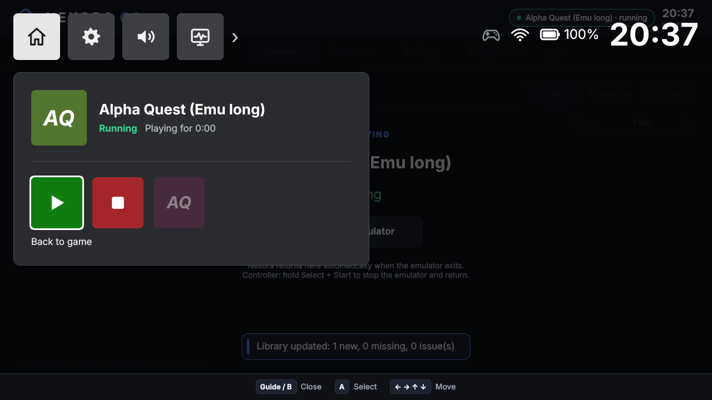
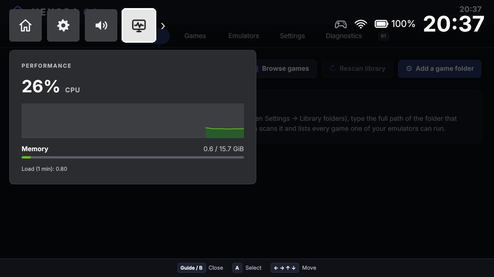

# Game bar

The game bar is a quick overlay that opens on top of the dashboard or a running emulator and closes again without leaving what you were doing. It is laid out like the Xbox Game Bar: a row of square widget buttons at the top left, the panel of the selected widget underneath, and status icons with a large clock at the top right. It covers the whole window, header and hint bar included.

| | Controller | Keyboard |
| --- | --- | --- |
| Open / close | Guide (Xbox / PS / Home button) when no game is running | Ctrl+G (always) |
| Close | Guide, East (B) | Esc, Backspace, Ctrl+G |
| Choose a widget (its panel follows) | Left / Right on the buttons | ← → |
| Enter the panel / back to the buttons | Down (or A) / Up | ↓ (or Enter) / ↑ |
| Move along a row of tiles | Left / Right | ← → |
| Activate | South (A) | Enter, Space |
| Volume | Left / Right on the volume slider | ← → on the slider |

The bar opens on the Home button. A click outside the panel also closes it. While the bar is open, nothing reaches the dashboard or the running-emulator overlay underneath. The label of the focused tile is shown under its row.

The Guide button is the `gameBar` action in `input.mapping` and can be remapped like the other actions ([controller-support.md](controller-support.md#configurable-mapping)). If Guide is not bound to anything, it still opens the game bar, so mappings saved before the bar existed keep working.

## Widgets

| Button | Panel |
| --- | --- |
| Home | The game in focus: placeholder cover art, title, state and play time (idle: the Nexora mark and version). Below, a row of tiles: while a game runs **Back to game** and **Stop emulator** (needs a second press); with nothing running **Nexora home** and **Game library**. Then up to four recently played games, which launch directly (disabled while a game runs: one emulator at a time). |
| Quick settings | **All settings** (the dashboard's Settings tab; not while a game runs), **Restart** and **Power off** (each asks through a confirmation dialog, "Restart Nexora?" / "Power off?", default Cancel, which says that a running emulator will be stopped; only enabled where power control is available), connected controllers. |
| Audio | Volume slider (the `audio.volume` setting; applied only on the embedded platform, see [settings.md](settings.md#keys)). |
| Performance | CPU usage with a graph of the last 30 seconds, memory used / total, 1-minute load average. |

Status icons (top right), from real data only, hidden when there is nothing to show:

| Icon | Source |
| --- | --- |
| Controller | White when a controller is connected, grey otherwise. |
| Network | Wi-Fi or wired icon when a hardware interface is up (`/sys/class/net/*/operstate`; interfaces without a `device` link, such as bridges and veth, are ignored; wired wins over Wi-Fi). Hidden with no link. |
| Battery | Level and charging state of the first battery (`/sys/class/power_supply/*/{type,capacity,status}`). Hidden on machines without one. Red at 15 % or less while discharging. |

There is no microphone indicator: Nexora has no microphone handling.

Performance figures come from `/proc/stat` and `/proc/meminfo`, status icons from `/sys`; everything is sampled once per second, **only while the bar is open**; a closed bar costs nothing. The first CPU figure appears one second after opening (it needs two samples).

## Over a running emulator

Since MVP 4, **Guide opens the quick menu instead of the bar while a game runs** (holding Start for 1 s does too); the quick menu has Return to game, Suspend and go Home ([Quick Resume](quick-resume.md)), Pause/Resume, controller status, audio, display settings, system info and Exit game ([controller-support.md](controller-support.md#quick-menu-and-game-bar)). The bar itself is still available over a running game with Ctrl+G.

Controller navigation of the launcher is normally suspended while an emulator runs, because the pad is not grabbed and the emulator should get it. Guide and the Start hold are the exceptions: they are reported even while suspended (`InputController::gameBarRequested`, `quickMenuRequested`). Opening the bar or the quick menu then:

1. lifts the suspension, so the pad drives the bar;
2. if the Nexora window is not the active window, raises and activates it (`QWindow::raise()` / `requestActivate()`).

Closing the bar (Guide, Back or **Back to game**) suspends navigation again and, if the bar raised the window, lowers it so the emulator window is in front again.

## Limitations

- **The game keeps running and still sees the pad.** Devices are not grabbed, so buttons pressed while the bar is open also reach the emulator. The bar has no pause; the quick menu can pause emulators whose definition is `pausable` (SIGSTOP).
- Raising and lowering the window depends on the window manager. On a bare KMS/EGLFS setup without one, whether the emulator or Nexora is visible is decided by the display stack, not by the bar.
- No capture (screenshot / recording) or social widget, no GPU, FPS or temperature figures, no per-game audio mix.
- No cover art yet: games are shown with generated placeholder art (initials on a per-title colour).
- The CPU figure is the whole system, not just the emulator.

## Implementation

| Part | File |
| --- | --- |
| QML overlay | `apps/console-ui/qml/GameBar.qml` (parented to the window's `Overlay.overlay` in `Main.qml`, above everything) |
| Icons | `apps/console-ui/qml/BarIcon.qml` (drawn with `Canvas`, no icon font needed) |
| State, sampling, session time | `apps/console-ui/src/GameBarController.{h,cpp}` (QML context property `gameBar`) |
| CPU counters, battery and network | `SystemIntegration::cpuTimes()`, `deviceStatus()` in `apps/system/` |
| Guide → `gameBarRequested` | `InputController::injectAction()`, `ButtonMapping` (`gameBar` action) |
| Input suspension | `AppController::setGameBarOpen()` |

Tests: `tst_qmlsmoke` (`gameBarOverlay`), `tst_appcontroller` (`gameBarOverRunningEmulator`), `tst_inputcontroller`, `tst_buttonmapping`, `tst_systemintegration`.
