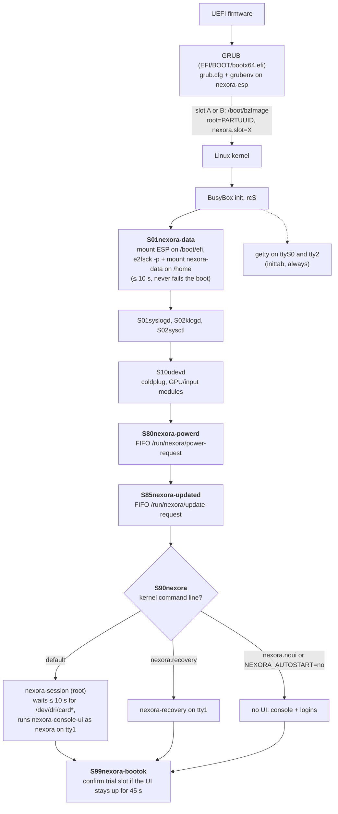

# Recovery

How Nexora OS behaves when something goes wrong at boot, during an update, or in the console UI, and what you can do about it. Everything here is implemented in the Buildroot tree; **none of it has been exercised on a booted A/B image yet** (the GRUB script was only syntax-checked, the shell helpers were tested on the build host against scratch files). <!-- TASK12-RESULT: replace with what was verified in QEMU (boot, recovery menu, rollback) -->

Related: [update-system.md](update-system.md) (slots and boot counting), [user-data.md](user-data.md) (backups), [troubleshooting.md](troubleshooting.md), [buildroot.md](buildroot.md).

## Contents

- [Boot and service dependencies](#boot-and-service-dependencies)
- [Recovery mechanisms at a glance](#recovery-mechanisms-at-a-glance)
- [GRUB menu](#grub-menu)
- [Recovery menu](#recovery-menu)
- [Console UI crash loop](#console-ui-crash-loop)
- [Failed update: automatic rollback](#failed-update-automatic-rollback)
- [Procedures](#procedures)
- [Limitations](#limitations)

## Boot and service dependencies

BusyBox init runs `/etc/init.d/S??*` in name order. Nexora adds five scripts (bold):

No step waits indefinitely on optional hardware: the data partition wait is bounded to 10 s, the DRM wait to 10 s (the UI then starts anyway), and the boot-ok check runs in the background.

## Recovery mechanisms at a glance

| Problem | Mechanism | Automatic? |
| --- | --- | --- |
| New root slot does not boot or the UI never comes up | GRUB boot counting: 3 tries, then back to the confirmed slot | Yes |
| You want the previous system back after a confirmed update | GRUB "Nexora OS (previous slot)" or recovery menu option 2 | No |
| Console UI crashes repeatedly | Supervisor backoff (1, 2, 4 … 30 s); after 5 runs shorter than 15 s it gives up and switches to the tty2 login | Yes |
| Broken preferences | Recovery menu "Reset UI preferences"; or the UI moves an unparsable `settings.json` aside by itself | Partly |
| Lost or damaged library/settings | Restore a backup (UI, `--restore`, or recovery menu) | No |
| Data partition missing or unclean | `S01nexora-data` skips it after 10 s or mounts it read-only | Yes (degraded) |
| Need logs from a failed start | recovery menu "Export diagnostics" (includes the last lines of `/run/nexora-session/session.log` and `/var/log/nexora/console-ui.log`, masked), or copy the full files from a shell | No |
| `grubenv` damaged (e.g. a power cut while it was rewritten) | GRUB and the helpers fall back to `grubenv.bak`; recovery menu "Repair boot environment" recreates both | Partly |

## GRUB menu

Shown for 3 seconds at every boot (press an arrow key to stop the countdown):

| Entry | Kernel arguments | Use it when |
| --- | --- | --- |
| Nexora OS | slot chosen by grubenv | normal boot |
| Nexora OS (previous slot) | the other slot, grubenv unchanged | the current slot works badly; boots the other slot once |
| Nexora OS (recovery menu) | `nexora.recovery` | you need the text recovery menu (keyboard required) |
| Nexora OS (maintenance shell: no console UI) | `nexora.noui` | you need tty1 as a normal console, e.g. to debug the UI start |

"Previous slot" does not change `nexora_slot`; if you want to stay on the other slot, use recovery menu option 2, which arms it as a trial so that `nexora-bootok` makes it permanent once the UI starts.

## Recovery menu

`/usr/libexec/nexora/nexora-recovery` runs as root on tty1 instead of the UI when the kernel command line contains `nexora.recovery`. It needs a **keyboard**. Every action runs fixed commands; actions on user files run as the `nexora` user (so a planted symlink in the home directory cannot redirect a root write).

| Option | What it does |
| --- | --- |
| 1) Show slots and versions | running slot, the three grubenv variables, version and build id of both slots (the other slot is mounted read-only to read its `/etc/nexora-release`), whether the data partition is mounted on `/home` |
| 2) Boot the other (previous) slot | after confirmation sets `nexora_try=<other> nexora_tries=3` and reboots; the other slot becomes the default only after it has started the UI successfully, otherwise the system returns to the current slot |
| 3) Reset UI preferences | renames `/home/nexora/.config/nexora/settings.json` to `settings.json.reset-<date>`; library, saves and backups untouched |
| 4) Export diagnostics to /home/nexora | first runs the console UI's own redacting export as the `nexora` user (`nexora-console-ui --export-diagnostics`, offscreen; the report lands in `/home/nexora/.local/state/nexora/diagnostics/`, see [user-data.md](user-data.md)); then writes `recovery-diagnostics-<timestamp>.txt` with the boot state: `/etc/nexora-release`, kernel and command line, grubenv (or which of `grubenv`/`grubenv.bak` was read), pending update record, mounts, disk usage. That file also always gets the last 100 lines of the session and UI logs and the last 200 kernel log lines. The whole file passes through a masking filter (`nexora_mask_secrets`): values of password/token/secret/key/auth/cookie/session-like fields, credentials in URLs and bearer tokens become `***`, and `/home/nexora` becomes `~` |
| 5) Restore the latest backup | finds the newest `nexora-backup-*` in `/home/nexora/.local/share/nexora/backups` and runs `nexora-console-ui --restore` on it (offscreen) after confirmation |
| 6) Repair boot environment | shows the current boot environment (or that `grubenv` and `grubenv.bak` are missing or damaged) and, after confirmation, recreates `grubenv` and `grubenv.bak` from defaults: the running slot becomes the confirmed slot, any pending trial boot is cancelled and the pending update record is removed. Needs a known running slot and the ESP mounted on `/boot/efi` |
| 7) Reboot | `sync` and reboot |
| 8) Shell login | `login` (root has no password on the development image) |

The masking filter in option 4 is a simple `sed` pattern, weaker than the application's redaction ([security.md](security.md#privacy-and-redaction)); read the file before sharing it. The UI's own export carries only the log of its short headless run, which is why the masked tail of the failed session's logs is always appended; for the complete files, copy `/var/log/nexora/console-ui.log` and `/run/nexora-session/session.log` to `/home/nexora` from a shell (option 8).

## Console UI crash loop

`/usr/libexec/nexora/nexora-session` restarts `nexora-console-ui` whenever it exits, with a delay of 1, 2, 4, … up to 30 s; a run of at least 15 s resets the backoff. After **5 consecutive runs shorter than 15 s** it logs the failure and switches to tty2 (`chvt 2`), where a login prompt is waiting. The limits are configurable in `/etc/default/nexora` (`NEXORA_MAX_RAPID_FAILURES`, `NEXORA_RAPID_SECONDS`).

Each restart ("nexora-console-ui exited with status N after Ns; restarting in Ns") and giving up are also written to the kernel log (`/dev/kmsg`), so they appear on the serial console; `scripts/image/qemu-boot-test.sh` watches for them. Before every start the supervisor increments `/run/nexora-session/ui-starts`, which `nexora-bootok` uses to tell a UI that stayed up from one that was restarted.

Where to look:

| Log | Content |
| --- | --- |
| `/run/nexora-session/session.log` | supervisor messages and the UI's stdout/stderr — early Qt errors (EGLFS/KMS, missing QML modules) only appear here |
| `/var/log/nexora/console-ui.log` | the application log |
| `/var/log/messages` | syslog: `nexora-session`, `nexora-powerd`, `nexora-updated`, `nexora-bootok`, `nexora-data` |

All three are on tmpfs and are lost at reboot; copy the files to `/home/nexora` from a shell first (recovery menu option 4 includes their last lines, masked; see above).

A crash loop on a slot that is still on trial is not confirmed by `nexora-bootok` (a single restart during its 45 s window is enough to withhold the confirmation), so GRUB rolls back after the remaining tries.

## Failed update: automatic rollback

See [update-system.md](update-system.md#slots-grubenv-and-boot-counting) for the full state machine. In short:

1. `nexora-updated` writes the new image to the inactive slot, verifies it, and sets `nexora_try=<new> nexora_tries=3`.
2. Each boot GRUB decrements the counter before loading the kernel and boots the new slot.
3. If the UI runs for 45 s without being restarted, `nexora-bootok` confirms the slot.
4. If it never does, the fourth boot finds `nexora_tries=0`, clears the trial and boots the confirmed slot; `nexora-bootok` there records "rolled-back" in `last-update.json`, and the UI reports "The update to <new> did not start correctly, so Nexora OS went back to <previous>" (`RecoveryRequired`; Home card "Update rolled back") until you press **OK** in the update panel. Not verified on the image; the recovery menu's slot view and `/var/log/messages` (`nexora-bootok`) show the same information.

The try is used up as soon as GRUB starts the kernel, so a trial boot that hangs also counts. No hardware watchdog is configured, so a hang needs a manual power cycle.

## Procedures

### The system does not start the UI after an update

1. Power-cycle up to three times; the fourth boot returns to the previous slot automatically.
2. Or, at the GRUB menu, choose **Nexora OS (previous slot)** for an immediate boot of the old system.

### The UI starts but behaves badly after a confirmed update

1. Reboot, choose **Nexora OS (recovery menu)**.
2. Option 1 to check both slots' versions, then option 2 to boot the other slot on trial; it becomes the default once its UI has started.

### Preferences make the UI unusable

1. Boot the recovery menu, option 3 (Reset UI preferences), option 7 (Reboot).
2. Alternatively, from a shell: `mv /home/nexora/.config/nexora/settings.json /home/nexora/.config/nexora/settings.json.off`.

### Updates fail with "boot environment (grubenv) not found or damaged"

1. Boot the recovery menu, option 1 to see which slot is running and what the boot environment contains.
2. Option 6 (Repair boot environment) recreates `grubenv` and `grubenv.bak` with the running slot confirmed and no trial pending; option 7 reboots.

### Restore user data from a backup

- In the UI: Settings › System › Restore backup.
- In the recovery menu: option 5 (latest backup).
- From a shell, as user `nexora`: `nexora-console-ui --restore /home/nexora/.local/share/nexora/backups/nexora-backup-<timestamp>`.

Current files are moved aside as `*.pre-restore-<timestamp>` before anything is replaced ([user-data.md](user-data.md#backup-and-restore)).

### Get a root shell

The serial console (ttyS0, 115200 baud) and tty2 always offer a login; on the development image root has no password. Or boot "maintenance shell: no console UI". From a shell: `/etc/init.d/S90nexora stop|start|restart`, and `NEXORA_AUTOSTART=no` in `/etc/default/nexora` to keep the UI off.

### Repair the data partition

From a root shell: `umount /home` (stop the UI first with `/etc/init.d/S90nexora stop`), then `e2fsck -f /dev/disk/by-partlabel/nexora-data`, then reboot.

### Re-install from scratch

Write a release disk image to the disk again ([installation.md](installation.md)). This **erases the data partition**; copy `/home/nexora` (or at least the backups directory) to another medium first.

## Limitations

- A keyboard is required in the recovery menu and at the GRUB menu; neither works with a controller.
- No hardware watchdog: a kernel hang during a trial boot needs a manual power cycle (each counts as a try).
- GRUB and its configuration on the ESP are never updated by bundles; a damaged ESP needs a re-install.
- The recovery diagnostics export prefers the application's redacted report; its own boot-state file (and the raw log fallback) is only masked by a `sed` pattern, which is weaker than the application's redaction.
- Logs are volatile (tmpfs).
- Nothing on this page has been executed on a booted image; see the verification status at the top.
