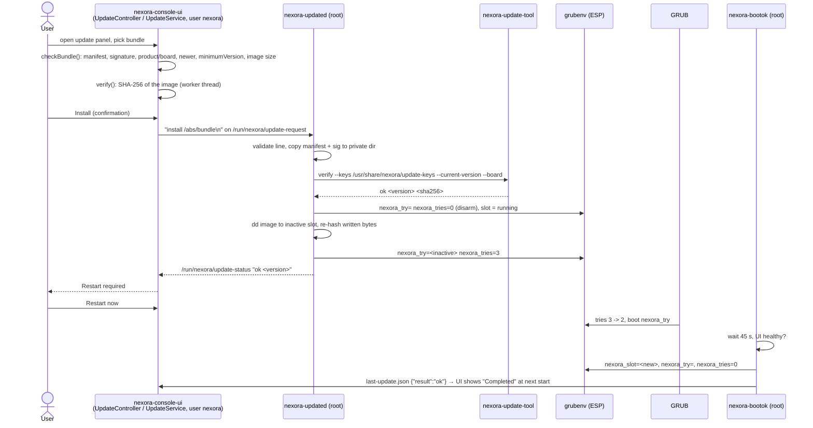
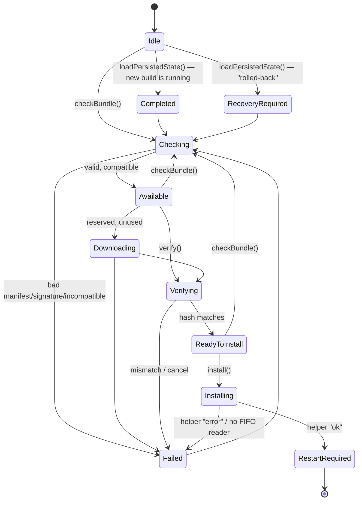
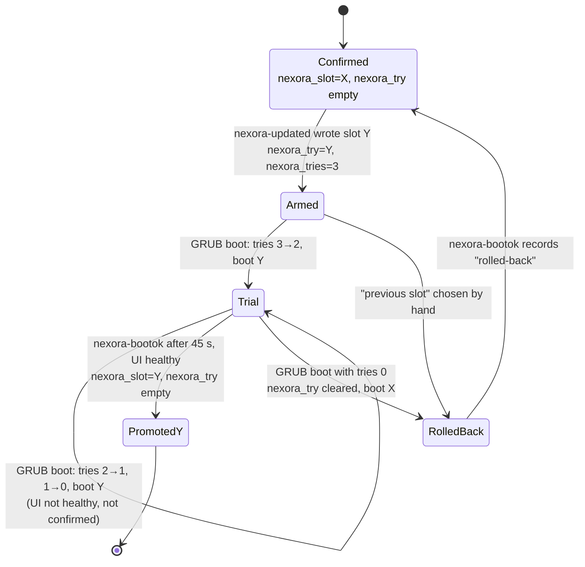

# Update system

Nexora OS updates the whole root filesystem: a signed **update bundle** carries one root filesystem image, which is written to the **inactive** of two root slots (A/B). GRUB then boots the new slot on trial; if the console UI comes up and stays up, the slot is confirmed, otherwise GRUB falls back to the previous slot after three attempts. User data lives on a separate partition and is not touched.

> **Verification status.** The application side (manifest parsing, Ed25519 verification, hashing, the state machine, the install request) is covered by automated tests. The image side (root helper `nexora-updated`, `nexora-bootok`, GRUB boot counting) is implemented; the helpers were tested only on the build host against scratch files and a scratch `grubenv` (`test_update_helper`), and `grub.cfg` was only syntax-checked (`grub_cfg_syntax`). **No update has been installed on a booted image, no trial boot or rollback has been executed in a VM or on hardware.** <!-- TASK12-RESULT: record the A/B install/rollback test in QEMU here if Task 12 runs it -->

Code: `apps/update/` (`Version`, `UpdateManifest`, `SignatureVerifier`, `sha256File`, `UpdateService`), `apps/update/tools/nexora-update-tool.cpp`, `apps/console-ui/src/UpdateController.cpp`, `apps/console-ui/qml/UpdatePanel.qml`; on the image `buildroot-external/board/nexora-x86_64/grub.cfg` and `rootfs-overlay/usr/libexec/nexora/{nexora-updated,nexora-bootok,nexora-functions}`. Recovery procedures: [recovery.md](recovery.md). Signing and releases: [release-process.md](release-process.md).

## Contents

- [Trust model](#trust-model)
- [Bundle format](#bundle-format)
- [End-to-end flow](#end-to-end-flow)
- [Application state machine](#application-state-machine)
- [Verification steps and errors](#verification-steps-and-errors)
- [The root helper (nexora-updated)](#the-root-helper-nexora-updated)
- [Slots, grubenv and boot counting](#slots-grubenv-and-boot-counting)
- [Boot confirmation and rollback record](#boot-confirmation-and-rollback-record)
- [Using it](#using-it)
- [nexora-update-tool](#nexora-update-tool)
- [Supported and unsupported scenarios](#supported-and-unsupported-scenarios)
- [Tests](#tests)

## Trust model

- Release maintainers hold one or more **Ed25519 private keys offline**. The repository never contains a private key: tests generate throwaway keys at run time; `scripts/release/sign-update.sh` refuses keys that live inside a git work tree.
- The matching **public keys** (PEM) are installed read-only in the image at `/usr/share/nexora/update-keys/*.pem`, from `buildroot-external/board/nexora-x86_64/update-keys/` at image build time (that directory holds only a README; release builds drop the release public key there). Development build: `<build>/share/nexora/update-keys` (empty).
- A bundle is accepted only if `manifest.json.sig` is a valid Ed25519 signature, by **any one** installed key, over the **exact bytes** of `manifest.json`. The manifest pins the image by exact size and SHA-256.
- **No key installed → every update is refused** (fail closed; `tst_signatureverifier::failsClosedWithZeroKeys`, `fromDirectoryFailsClosedWithNoKeys`). A key file that is not an Ed25519 public key is skipped with an issue.
- **Rotation:** ship the new public key in an update signed by a still-trusted key. **Revocation:** ship an update, signed by a still-trusted key, without the revoked key. There is no other revocation mechanism.

## Bundle format

A plain directory (on a USB stick or in the home directory) named `nexora-update-<version>`:

```
nexora-update-0.4.1/
  manifest.json       ≤ 64 KiB
  manifest.json.sig   raw 64-byte Ed25519 signature over manifest.json's exact bytes
  rootfs.ext4         the root filesystem image for one slot
```

```json
{
  "format": 1,
  "product": "nexora-os",
  "board": "nexora-x86_64",
  "version": "0.4.1",
  "buildId": "v0.4.1-0-gabcdef0",
  "minimumVersion": "0.4.0",
  "releasedAt": "2026-10-11T00:00:00Z",
  "image": {"file": "rootfs.ext4", "size": 2147483648, "sha256": "<64 lowercase hex>"},
  "notes": "≤ 4000 chars"
}
```

| Field | Rule (`UpdateManifest::parse()`) |
| --- | --- |
| `format` | exactly `1` |
| `product` | must equal `nexora-os` (`WrongProduct`) |
| `board` | must equal the running board, `nexora-x86_64` (`WrongBoard`) |
| `version`, `minimumVersion` | strict `^\d{1,4}\.\d{1,4}\.\d{1,4}$` (no `v`, no suffix) |
| `buildId` | non-empty string |
| `releasedAt` | ISO-8601 date-time |
| `image.file` | plain name, ≤ 128 chars, `^[A-Za-z0-9._-]+$`, no `/`, no `..` |
| `image.size` | 1 byte – 64 GiB |
| `image.sha256` | exactly 64 lowercase hex characters |
| `notes` | optional string, ≤ 4000 characters |
| other keys | rejected: the signature pins exactly this document |

`scripts/release/make-release.sh` writes the manifest (unsigned) next to `rootfs.ext4` when a Buildroot image exists; `scripts/release/sign-update.sh --key KEY --bundle DIR` signs it ([release-process.md](release-process.md)).

## End-to-end flow



## Application state machine

`UpdateState` and `isValidTransition()` (`apps/update/src/UpdateService.cpp`, table tested by `tst_updateservice`):



`Downloading` exists in the enum and the table but nothing produces it: there is no network delivery. `RestartRequired` is terminal in the running process; the user restarts with **Restart now** (or the power menu).

## Verification steps and errors

| Step | Where | Error (`UpdateError`) |
| --- | --- | --- |
| Manifest ≤ 64 KiB, parses, strict schema | `checkBundle()` | `BadManifest` |
| At least one usable key | `checkBundle()` | `NoKeys` |
| Signature valid for one key | `checkBundle()` | `BadSignature` |
| Product / board | `checkBundle()` | `WrongProduct`, `WrongBoard` |
| Version strictly newer than running | `checkBundle()` | `NotNewer` |
| Running version ≥ `minimumVersion` | `checkBundle()` | `TooOld` |
| Image exists, size matches (`stat()` only) | `checkBundle()` | `ImageMissing`, `SizeMismatch` |
| SHA-256 of the image (1 MiB chunks, cancellable) | `verify()` worker thread | `HashMismatch`, `Cancelled` |
| Helper reachable (`O_NONBLOCK` open of the FIFO) | `install()` | `InstallRequestFailed` |
| Helper result (`/run/nexora/update-status`, polled every 500 ms) | `install()` | `InstallFailed` |
| Another operation running | any | `Busy` |

The bundle is never copied by the application; the image stays on its medium until the root helper writes it to the inactive slot (which must be large enough, checked by the helper). `last-update.json` lives in `<state>/update` (`~/.local/state/nexora/update`).

On the desktop build the update panel is **not supported** (`UpdateController.supported` is false unless `NEXORA_UPDATE_TEST=1`) and says "Updates are installed only on the Nexora OS image".

## The root helper (nexora-updated)

`/usr/libexec/nexora/nexora-updated`, started by `/etc/init.d/S85nexora-updated`, owns the FIFO `/run/nexora/update-request` (`root:nexora 0620`; directory `/run/nexora` `root:nexora 0750`). It trusts nothing from the requester:

1. The line must be `install <path>` with `path` absolute, 2–256 characters, only `[A-Za-z0-9._/ -]`, and no `..`. Anything else → `error invalid request` (and a 1 s pause).
2. The running slot comes from `nexora.slot=` on the kernel command line; the target is the other slot.
3. `manifest.json` (≤ 64 KiB) and `manifest.json.sig` (≤ 64 bytes) are copied into the root-only directory `/run/nexora-updated`, so they cannot change after verification. The image file name is restricted to the manifest's character set before it is referenced.
4. `nexora-update-tool verify` runs with the image's own keys, the version from `/etc/nexora-release` and the board `nexora-x86_64`.
5. The image must fit the target partition; the target must not be mounted.
6. Any pending trial is disarmed first (`nexora_try=`, `nexora_tries=0`; `nexora_slot` set to the running slot).
7. The image is written with `dd … conv=notrunc,fsync`, page caches are dropped, and the first `size` bytes of the partition are hashed again and compared with the signed SHA-256 (this also closes the window in which the bundle could have been swapped after step 4).
8. Only then the trial boot is armed: `nexora_try=<target> nexora_tries=3`, and a record (`format=1`, target, previous/new version and build id) is written to `/boot/efi/nexora/update-pending` (ESP, root-only).
9. Status `ok <version>` or `error <reason>` (sanitised, ≤ 160 characters) in `/run/nexora/update-status` (`root:nexora 0640`).

Nothing from the bundle is executed, sourced or evaluated. Paths and devices can be overridden only in its test mode (`NEXORA_UPDATED_TEST=1`).

## Slots, grubenv and boot counting

Partitions (GPT names): `nexora-esp` (GRUB, `grub.cfg`, `grubenv`; no kernel), `nexora-rootA`, `nexora-rootB` (each with its own kernel at `/boot/bzImage`), `nexora-data`. `grubenv` (`EFI/BOOT/grubenv`) holds three variables:

| Variable | Values | Meaning |
| --- | --- | --- |
| `nexora_slot` | `A` / `B` | confirmed (known good) slot; anything other than `B` is treated as `A` |
| `nexora_try` | `A` / `B` / empty | slot on trial after an update |
| `nexora_tries` | `3` … `0` | trial boots left |

`grub.cfg` loads only these three variables. While `nexora_try` is set, each boot first decrements `nexora_tries` (3 → 2 → 1 → 0) and **saves it before loading the kernel**, then boots `nexora_try`. With no tries left (or an invalid value) the trial is abandoned (`nexora_try` cleared) and the confirmed slot boots. If the counter cannot be saved, the confirmed slot boots, so a broken slot can never be retried forever.



Menu entries: "Nexora OS" (the slot chosen above), "Nexora OS (previous slot)" (the other slot, without touching grubenv), "Nexora OS (recovery menu)" (`nexora.recovery`), "Nexora OS (maintenance shell: no console UI)" (`nexora.noui`). Every entry passes `nexora.slot=<A|B>` and `root=PARTUUID=<fixed slot UUID>`.

## Boot confirmation and rollback record

`/usr/libexec/nexora/nexora-bootok` (background, from `/etc/init.d/S99nexora-bootok`):

- **Running slot = `nexora_try`:** wait `NEXORA_BOOTOK_DELAY` (45 s, overridable in `/etc/default/nexora`), then require that the session supervisor and `nexora-console-ui` are both running. If so: `nexora_slot=<slot> nexora_try= nexora_tries=0`, status `ok <version>`, and `last-update.json` written **as the `nexora` user** into `~/.local/state/nexora/update/`. If not (crash loop, `nexora.noui`, `nexora.recovery`, autostart disabled): nothing is confirmed; the next boot uses another try.
- **A pending record exists but the other slot is running** (tries used up, or previous slot picked by hand): the trial is cancelled and `{"result": "rolled-back"}` is recorded.
- **`nexora_try` set without a record while the other slot runs:** the trial is cancelled.

`last-update.json` (`{"format":1,"result","previousBuildId","newBuildId","previousVersion","newVersion","slot"}`) is read once at UI start by `UpdateService::loadPersistedState()`: `result: "rolled-back"` → `RecoveryRequired` with "update to <new> failed and was rolled back to <previous>"; `newBuildId` equal to the running build → `Completed`, then the file is removed so it is shown only once.

The end-to-end update flow through the UI (panel → helper → reboot → confirmation or rollback → result shown in the UI) has **not been verified on the image**.

## Using it

On the image (none of these steps has been executed on a booted image yet):

1. Put the bundle directory `nexora-update-<version>/` on a stick. The panel lists `nexora-update-*` directories in `/media/*/`, `/run/media/*/*/` and `/home/nexora/`. **The image has no automounter**: either copy the bundle into `/home/nexora/` (for example from a root shell on tty2: `mount /dev/sdX1 /mnt && cp -r /mnt/nexora-update-0.4.1 /home/nexora/ && chown -R nexora:nexora /home/nexora/nexora-update-0.4.1`), or mount the stick under `/media/<name>/` by hand.
2. System tab › Software update (or Settings › System, or the Home update card): pick the bundle → **Check** → **Verify** (progress) → **Install** (confirmation).
3. When the panel says "Installed — restart to finish the update", select **Restart now**.
4. After about 45 s on the new version the slot is confirmed and the next start of the UI reports the update as completed. If the new slot does not start the UI three times, the previous slot boots and the UI reports the rollback. The System tab always shows the running version and build.

Headless check (no install): `nexora-console-ui --verify-update <bundle dir>` prints the final state (`readytoinstall: …`) and exits 0 when the bundle verified.

## nexora-update-tool

```
nexora-update-tool verify --keys DIR --bundle DIR [--current-version X --board B]
```

Runs the signature, compatibility, size and hash checks with no side effects. Prints `ok <version> <sha256>` (exit 0) or `error <UpdateError name> <message>` (exit 1). Without `--current-version`/`--board` it only answers "authentic and intact". There is deliberately no `sign` subcommand: signing uses the `openssl` CLI in `scripts/release/sign-update.sh`.

## Supported and unsupported scenarios

| Scenario | Status |
| --- | --- |
| Signed, newer bundle for `nexora-x86_64`, installed from the UI on the image | Implemented; **not verified on a booted image** |
| Tampered image, wrong signature, unknown key, malformed manifest, wrong board/product, same or older version, running version below `minimumVersion` | Refused (tested in `tst_updatemanifest`, `tst_signatureverifier`, `tst_updateservice`, `test_update_tool`, and for the root helper in `test_update_helper`) |
| Image larger than the slot (2 GiB) | Refused by the helper (tested against scratch files) |
| New slot fails to start the UI | Automatic fallback after 3 boots — implemented, **only simulated** with `grub-editenv` in `test_update_helper`; GRUB itself was not executed |
| Power loss while writing the inactive slot | The trial is armed only after the write and re-hash succeed, so the confirmed slot still boots — by design, **not tested** |
| Power loss during the confirmation | grubenv is written with one `grub-editenv set`; not tested |
| Rollback after a confirmed slot later breaks | **Not automatic.** Choose "Nexora OS (previous slot)" in GRUB or "Boot the other (previous) slot" in the recovery menu (see [recovery.md](recovery.md)) |
| Downgrade to an older version | **Not supported** (the helper requires a newer version); booting the previous slot by hand is the only way back |
| Kernel/bootloader update | Kernels update with their slot; GRUB and `grub.cfg` on the ESP are **not updated** by bundles |
| Delta updates, network download, update channels | **Not implemented** (`Downloading` is reserved) |
| Updating the data partition layout or resizing it | **Not implemented** |
| Updates on the desktop build | Not supported by design (`supported = false`) |
| Secure Boot / measured boot | Not implemented ([security.md](security.md#known-limitations)) |

## Tests

| Test | Label | Covers |
| --- | --- | --- |
| `tst_version` | unit | version parsing and comparison |
| `tst_updatemanifest` | unit, security | every malformed-manifest case listed above |
| `tst_signatureverifier` | unit, security | valid/tampered message and signature, wrong size, RSA key rejected, zero keys fail closed, second of two keys |
| `tst_updateservice` | integration, security | full state machine with a freshly signed 3 MiB bundle; wrong board, not newer, too old, tampered image, cancel during hashing, no FIFO reader, real FIFO + status file → `RestartRequired`, transition table; writes the fixture bundles for the next two tests |
| `test_update_tool` | integration, security | the CLI on the good and the tampered bundle |
| `tst_updatecontroller` | integration | `supported` on desktop, check → verify → ready through the controller |
| `test_update_helper` | system | `nexora-updated --once` and `nexora-bootok` in test mode on 16 MiB scratch slots and a scratch grubenv: install into B and into A, tampered bundle, not newer, image larger than the slot, rejected request lines; confirmation, unhealthy UI, tries used up → rolled back, previous slot picked by hand, nothing pending |
| `grub_cfg_syntax` | system | `grub-script-check` on `grub.cfg` |
| `shellcheck_image_scripts` | system | `shellcheck -s sh` on all image scripts |
