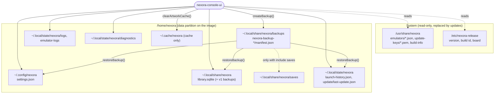

# User data

Where Nexora OS keeps your preferences, library, history, logs, backups and diagnostics, how those files are written, migrated, backed up and restored, and what survives an update.

Code: `shared/include/nexora/shared/DataLayout.h` (all directories in one place), `shared/src/AtomicFile.cpp`, `apps/system/src/BackupService.cpp`, `apps/game-library/src/GameDatabase.cpp` (schema migration), `apps/console-ui/src/SystemController.cpp` (UI entry points).

## Contents

- [Directory layout](#directory-layout)
- [On the image](#on-the-image)
- [How files are written](#how-files-are-written)
- [Versioned formats and migrations](#versioned-formats-and-migrations)
- [Backup and restore](#backup-and-restore)
- [Resetting and cleaning up](#resetting-and-cleaning-up)
- [What is not managed](#what-is-not-managed)
- [Limitations](#limitations)

## Directory layout

`DataLayout::fromEnvironment()` derives every directory from the XDG base directories (a relative or empty `XDG_*` value is ignored and the home-relative fallback is used). Paths are always absolute. `UiContext::start()` creates them with mode 0700 (owner only) on every start (`DataLayout::ensureDirectories()`).

| Purpose | Directory | Contents | Safe to delete? |
| --- | --- | --- | --- |
| User configuration | `$XDG_CONFIG_HOME/nexora` (`~/.config/nexora`) | `settings.json` ([settings.md](settings.md)) | Only to reset preferences |
| Game-library metadata | `$XDG_DATA_HOME/nexora` (`~/.local/share/nexora`) | `library.sqlite` (+ `-wal`, `-shm`), migration backups `library.sqlite.v1-backup-*` | No: favorites, play history, edited titles and notes live here |
| Save files | `<data>/saves` | reserved for emulator saves (see [limitations](#limitations)); included in a backup only on request | No |
| Emulator configuration | `<data>/emulators` | reserved for per-emulator configuration; not read by the UI yet | — |
| Backups | `<data>/backups` | `nexora-backup-<yyyyMMdd-hhmmss>/` | Yes, old ones |
| Artwork cache | `$XDG_CACHE_HOME/nexora` (`~/.cache/nexora`) | the only directory "Clear artwork cache" removes; nothing is downloaded today | Yes |
| State | `$XDG_STATE_HOME/nexora` (`~/.local/state/nexora`) | `launch-history.json`, `update/last-update.json` | Yes (history is lost) |
| Logs | `<state>/logs`, `<state>/emulator-logs` | `console-ui.log` (embedded default when `--log-file` is not given), per-emulator output logs `<id>.log`, `<id>.log.1` | Yes |
| Diagnostic reports | `<state>/diagnostics` | `diagnostics-<timestamp>.txt` (newest 10 kept) | Yes |
| System files | `/usr/share/nexora/` (image) or `<prefix>/share/nexora/` | emulator definitions, `systems.json` is compiled in, `update-keys/`, `build-info` | Not user data; replaced by updates |

The library database path is `<data>/library.sqlite` unless `--library-db` is given; this is the same path earlier releases used by default (`QStandardPaths::GenericDataLocation`), so no file had to move for MVP 4. The settings file is `$XDG_CONFIG_HOME/nexora/settings.json` unless `--settings-file` is given.



## On the image

The disk has a separate ext4 partition `nexora-data` (1 GiB, created empty) that `/etc/init.d/S01nexora-data` mounts on `/home` early in the boot; on first boot it creates `/home/nexora` (owner `nexora`, mode 0700). The root slots `nexora-rootA`/`nexora-rootB` contain only system files, so writing a new root image to the inactive slot does not touch user data. See [buildroot.md](buildroot.md) for the partition table and [update-system.md](update-system.md) for the slot logic.

| What | Path on the image |
| --- | --- |
| Settings | `/home/nexora/.config/nexora/settings.json` |
| Library | `/home/nexora/.local/share/nexora/library.sqlite` |
| Backups | `/home/nexora/.local/share/nexora/backups/` |
| Launch history, update record | `/home/nexora/.local/state/nexora/` |
| Diagnostic reports | `/home/nexora/.local/state/nexora/diagnostics/` |
| Recovery-menu diagnostics | `/home/nexora/recovery-diagnostics-<timestamp>.txt` |
| Application log | `/var/log/nexora/console-ui.log` (**tmpfs**, lost on reboot: the session supervisor passes `--log-file` there) |
| Supervisor log | `/run/nexora-session/session.log` (tmpfs) |

If the data partition does not appear within 10 s, `S01nexora-data` gives up and `/home` stays on the root filesystem: the UI still starts, but **its data is not persistent across updates** and is lost when the slot is rewritten. The recovery menu's "Show slots and versions" says whether the data partition is mounted. If `e2fsck -p` does not finish within the same budget or reports uncorrected errors, the partition is mounted read-only (settings changes and scans then fail to save; repair from a root shell with `e2fsck -f /dev/disk/by-partlabel/nexora-data`).

None of this has run on a booted image yet <!-- TASK12-RESULT: replace with the observed first-boot behaviour once the A/B image has been booted -->; the layout is implemented in `genimage.cfg`, `post-image.sh` and `S01nexora-data`. Resizing the data partition to fill a larger disk is **not implemented**.

## How files are written

- **Atomic replacement.** Every file the application owns is written with `QSaveFile` (temporary file in the same directory + rename) through `shared::writeFileAtomically()`, and ends up mode 0600. A crash or power loss leaves the old or the new file, never a truncated one. Tested: `tst_atomicfile`.
- **SQLite** runs in WAL mode; scan merges are single `BEGIN IMMEDIATE` transactions. An interrupted write leaves the database at the last committed transaction.
- **Corrupt files are moved aside, never overwritten.** `shared::moveAside()` renames to `<file>.corrupt-<yyyyMMdd-hhmmss>`: unparsable `settings.json`, an unusable `library.sqlite`, a corrupt `launch-history.json`. Nexora never deletes these; remove them by hand once inspected.
- **Bounded growth.** Launch history keeps 50 records; diagnostic reports keep the newest 10; the application log rotates at 2 MiB with 3 old files; emulator output logs are capped at 1 MiB with one previous run kept.

## Versioned formats and migrations

| File | Version field | Unknown/newer version |
| --- | --- | --- |
| `settings.json` | `"version": 1` | treated as unusable and moved aside ([settings.md](settings.md#validation-and-recovery)) |
| `library.sqlite` | `PRAGMA user_version` = 2 | a newer schema is refused and left byte-identical; the library is disabled for that run |
| `launch-history.json` | `"version": 1` | moved aside, history starts empty |
| backup `manifest.json` | `"version": 1` | restore refused |
| update `manifest.json` | `"format": 1` | bundle rejected |
| `last-update.json` (written by the image helper `nexora-bootok`) | `"format": 1` | read at UI start by `UpdateService::loadPersistedState()`; removed only when the user acknowledges the result in the update panel |
| `systems.json` (built in) | `"version": 1` | catalog load fails |

**Library migration v1 → v2** (`GameDatabase::open()`): before changing anything, the database file is copied (after a WAL checkpoint) to `library.sqlite.v1-backup-<yyyyMMdd-hhmmss>`; then the new columns (`system_id`, `system_override`, `system_candidates`, `title_override`, `notes`, `hidden`) and the version bump are applied in one transaction. If the copy or the transaction fails, `open()` fails, the original database stays usable by the old version and the backup exists. Migrating an already migrated database is a no-op (no second backup). Tested: `tst_librarymigration` (real v1 DDL, favorites and play counts preserved, backup opens as v1, version 99 refused untouched, second open makes no new backup).

## Backup and restore

A backup is a directory `nexora-backup-<yyyyMMdd-hhmmss>/` under `<data>/backups`:

```
manifest.json                {"version":1,"createdAt","appVersion","buildId","files":[{"path","sha256"}]}
config/settings.json         from ~/.config/nexora
data/library.sqlite          consistent snapshot (SQLite VACUUM INTO), not a raw copy
state/launch-history.json    if present
saves/...                    only when "include saves" was chosen (bounded to 4 GiB)
```

Logs, cache, diagnostics and the update record are never included.

### Creating a backup

| Where | How |
| --- | --- |
| UI | Settings › System › **Create backup** |
| Command line | `nexora-console-ui --backup [--include-saves]` (headless, prints the backup path, exit 0/1) |

If anything fails, the partial backup directory is removed. Saves larger than 4 GiB abort the backup with "saves are larger than 4 GiB; back them up separately".

### Restoring

| Where | How |
| --- | --- |
| UI | Settings › System › **Restore backup** (choose one, confirm in a dialog whose default button is Cancel) |
| Command line | `nexora-console-ui --restore <backup dir>` |
| Recovery menu (image) | "5) Restore the latest backup" — runs `nexora-console-ui --restore` on the newest backup as the `nexora` user |

Restore is all or nothing:

1. The manifest is read and **every** file is verified first: each path must be relative, must not contain `..`, must not be a symlink, must map to a known location, and its SHA-256 must match; a file in the backup that the manifest does not list is also a reason to refuse. Any problem → nothing is changed.
2. The UI cancels and waits for a running scan and closes the library database.
3. Each current file is renamed to `<file>.pre-restore-<timestamp>`, then the backup copy is put in place. If any step fails, every file already swapped in this restore is rolled back to its previous content.
4. The database is reopened, settings are reloaded and re-applied (volume, mute, mapping, dead zone, log level).

Tested: `tst_backupservice` (hash verification, tampered file refused with nothing changed, `../../etc/passwd` entry refused, saves only on request, `.pre-restore-*` left behind, listing order, multi-file rollback) and `tst_uicontext` (round trip through the controller, settings re-applied).

### Manual backup

To copy data off the device yourself, copy the whole `~/.config/nexora`, `~/.local/share/nexora` and, if you care about history, `~/.local/state/nexora` while Nexora is **not** running (or copy `library.sqlite` together with `library.sqlite-wal`).

## Resetting and cleaning up

| Action | What it does | What it never does |
| --- | --- | --- |
| Settings › System › Reset preferences (`SettingsController.resetToDefaults()`) | drops all overrides; old file kept as `settings.json.bak` | touch the library, saves or games |
| Recovery menu "Reset UI preferences" | renames `settings.json` to `settings.json.reset-<date>` | touch library, saves or backups |
| Settings › System › Clear artwork cache | deletes and recreates `~/.cache/nexora` only (`DataLayout::cacheOnlyDirs()`) | touch saves or data (tested: `tst_datalayout::cacheOnlyDirsExcludesUserData`) |
| Remove from library (game details) | hides the entry (`hidden = 1`); rescans never unhide it | delete or modify the game file (tested: `tst_gamelibrary::removeFromLibraryHidesButNeverDeletes`) |
| Settings › Library › Restore removed games | unhides all hidden entries | — |
| Settings › Library › Remove missing games | deletes the database rows of entries whose file is missing, with their favorites and history | touch any file on disk |

## What is not managed

- Game files, BIOS and firmware: Nexora only reads their names. Back them up separately.
- Emulator-owned configuration and saves written wherever each emulator puts them (often `~/.config/<emulator>`); on the image that is still inside `/home/nexora` and therefore on the data partition, but it is not part of a Nexora backup unless it is under `<data>/saves`.

## Limitations

- `<data>/saves` and `<data>/emulators` are reserved: no emulator is told to use them yet (there is no per-emulator save-path argument in the emulator definition format).
- Backups cover the settings file in the default location; a settings file given with `--settings-file` elsewhere is not backed up.
- No automatic or scheduled backups; no off-device backup target; backups are not encrypted.
- On the image the application log is on tmpfs (see [On the image](#on-the-image)).
- The data partition has a fixed size of 1 GiB and is not grown automatically.
